# Diagramas de secuencia de diseño

> **Alcance y criterio de lectura**
>
> Estos diagramas se elaboraron a partir de la estructura actual del backend y de
> `docs/3_diseño/ModaLinkBD.sql`.
>
> - **UC-24** refleja el flujo implementado actualmente.
> - **UC-26, UC-28 y UC-34** reflejan el diseño de los casos de uso a partir de
>   sus DSS, contratos y entidades persistentes. Los nombres de las capas de
>   aplicación se expresan según la responsabilidad que deben cumplir en el
>   diseño, independientemente de su estado de implementación.
> - La disponibilidad se calcula en backend mediante la agenda, bloqueos y
>   actividades existentes; no se trata como un dato persistido estático.

## UC-24 — Crear proyecto

**Implementación actual:** `POST /proyectos`, atendido por
`ProyectoController.crear` y `CrearProyectoService.crear`.

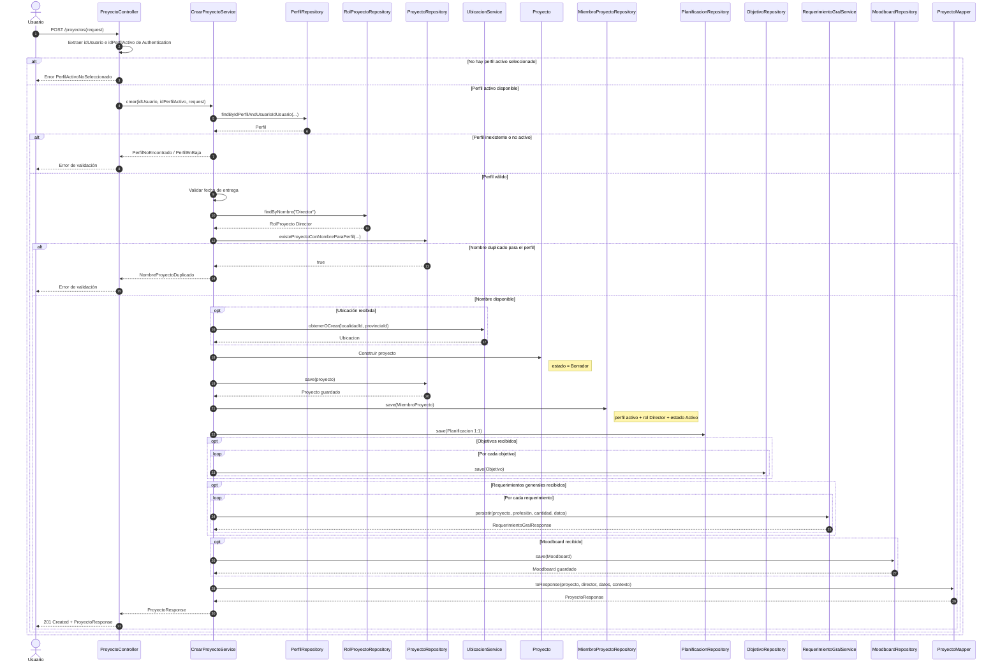

### Persistencia relevante de UC-24

La transacción crea o actualiza las siguientes relaciones:

1. `proyecto`, con estado `BORRADOR`.
2. `miembros_proyecto`, asociando el perfil activo al rol `DIRECTOR`.
3. `planificacion`, en relación 1:1 con el proyecto.
4. `objetivo`, si se enviaron objetivos.
5. `requerimiento_gral_proyecto` y sus características/habilidades, si se
   enviaron requerimientos.
6. `moodboard`, si se envió material de inspiración.

Los campos obligatorios del request son `nombre`, `descripcion` y `privacidad`.
La validación de Bean Validation ocurre antes de ingresar al servicio.

## UC-26 — Dar de alta postulación a proyecto

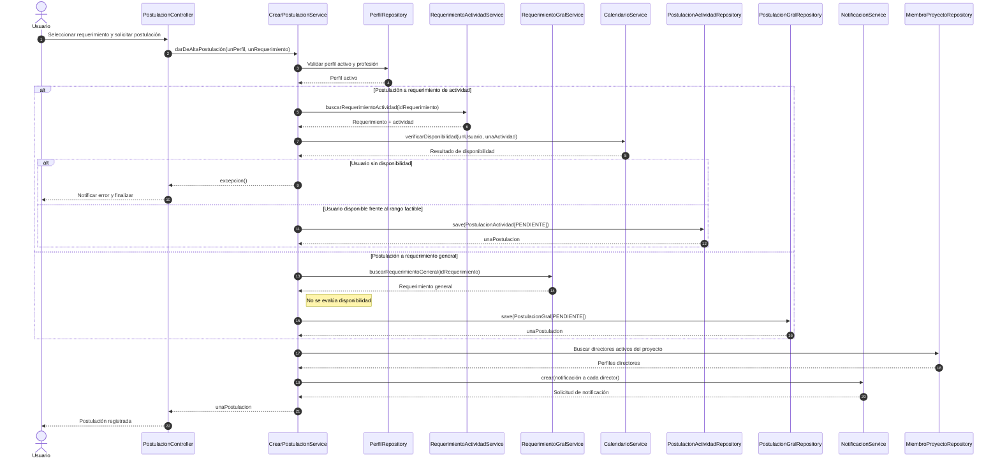

La postulación debe quedar inicialmente en estado `PENDIENTE`, asociada al
perfil y al requerimiento correspondiente. Se notifica a **todos** los
directores activos del proyecto con el tipo `POSTULACION_RECIBIDA`; la
notificación debe referenciar la postulación mediante `entidad_tipo` y
`entidad_id`.

Sólo los proyectos en estado `PUBLICADO` aceptan postulaciones (UC-60 los
cierra), el perfil debe estar activo, tener la profesión solicitada y no ser
miembro activo del proyecto. Un perfil no puede postularse dos veces al mismo
requerimiento (garantizado además por los índices únicos
`UQ_perfil_postulacion_act` / `UQ_perfil_postulacion_gral`). Sólo se admite
postular a actividades `PENDIENTE`.

La verificación de disponibilidad de UC-26 es **provisional**: mientras el
proyecto no tenga fecha de inicio confirmada se evalúa el rango
`[ahora, fecha de entrega]` en lugar del rango estricto `[ES, LF]` del CPM, y
la respuesta lo informa. La comprobación debe repetirse al confirmar el
proyecto (UC-60) y al asignar la actividad (UC-70).

Endpoints:

- `POST /proyectos/{idProyecto}/postulaciones/actividad` con
  `{ "idRequerimientoActividad": ... }`.
- `POST /proyectos/{idProyecto}/postulaciones/general` con
  `{ "idRequerimientoGral": ... }`.

## UC-28 — Aceptar solicitud de incorporación

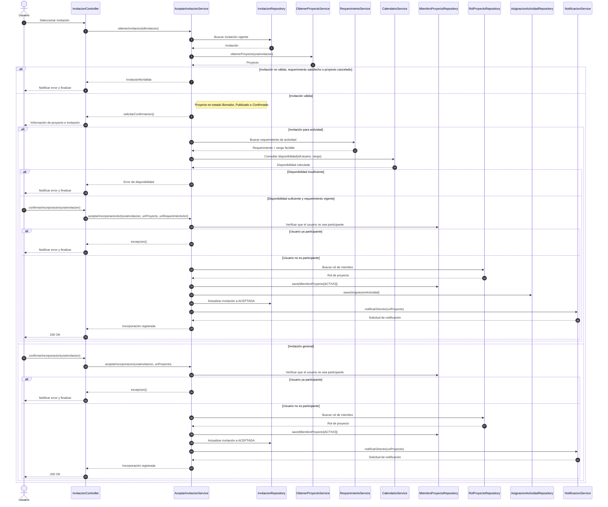

La rama de actividad agrega la validación de disponibilidad y la asignación de
la actividad al miembro. Si el perfil ya es miembro activo, se reutiliza la
membresía; si es Director, se rechaza. La rama general no consulta
disponibilidad porque no asigna una actividad concreta y rechaza la operación
si el perfil ya es miembro activo.

La invitación general puede estar asociada opcionalmente a un requerimiento
general. En ese caso se valida profesión y cupo, y la membresía se crea vinculada
al requerimiento. Si no tiene requerimiento, la membresía queda sin vínculo y no
consume cupo.

Cuando una aceptación cubre el cupo del requerimiento, se eliminan físicamente
todas las invitaciones pendientes de ese mismo requerimiento, de cualquier
director, sin notificar a los afectados. La operación notifica a los directores
con `INVITACION_ACEPTADA`.

El rechazo de una invitación se expone con los endpoints:

```http
POST /invitaciones/general/{idInvitacion}/rechazar
POST /invitaciones/actividad/{idInvitacion}/rechazar
```

Actualiza la invitación a `RECHAZADA`, no crea membresía ni asignación y notifica
a los directores con `INVITACION_RECHAZADA`. Los endpoints de aceptación son:

```http
POST /invitaciones/general/{idInvitacion}/aceptar
POST /invitaciones/actividad/{idInvitacion}/aceptar
```

## UC-34 — Gestionar postulaciones

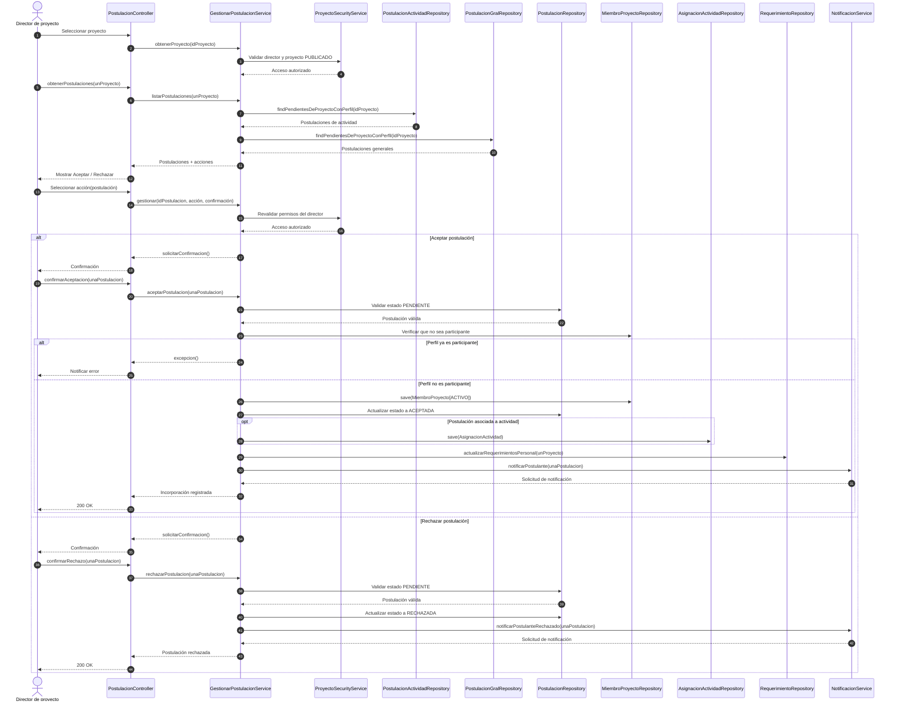

### Reglas de persistencia y consistencia

- La aceptación debe crear un registro `miembros_proyecto` activo y actualizar
  el estado de la postulación en una única transacción.
- El estado de la postulación utiliza los valores del modelo:
  `PENDIENTE`, `ACEPTADA` o `RECHAZADA`.
- La base de datos ya contiene triggers para controlar cupos al aceptar
  postulaciones. El servicio debe propagar los errores de integridad y no
  devolver una aceptación exitosa si la transacción falla.
- El rechazo debe conservar la postulación con estado `RECHAZADA` para que
  pueda auditarse y generar la notificación correspondiente; el contrato de
  `rechazarPostulacion` no indica eliminarla.

## UC-30 — Buscar invitaciones

La búsqueda se limita a las invitaciones recibidas o enviadas por el perfil
activo. Las invitaciones generales y de actividad se consultan por separado y
se unifican, filtran, ordenan y paginan en el servicio.

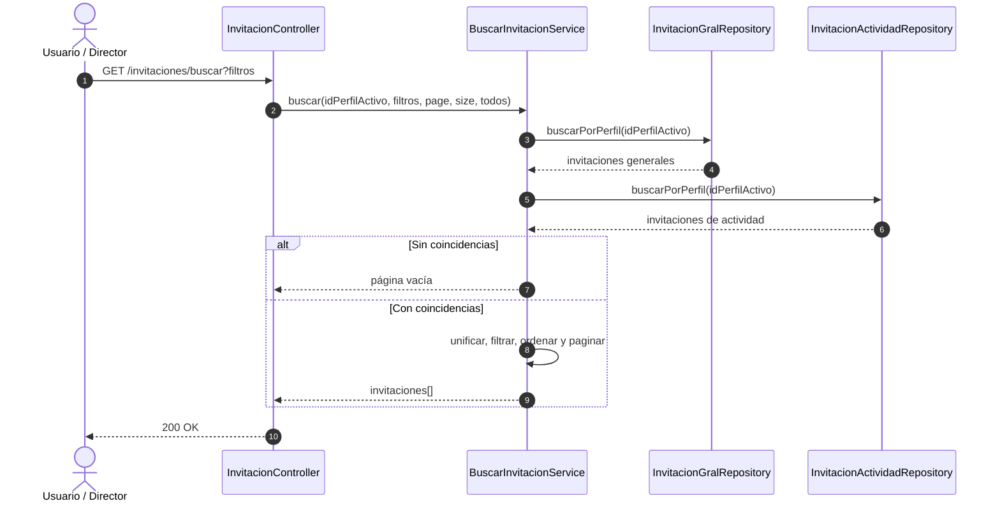

La respuesta incluye `tipo` para distinguir invitaciones generales de las de
actividad y `direccion` para indicar si el perfil activo es remitente o
destinatario. El filtro `nombrePerfil` se aplica al remitente en las recibidas,
al destinatario en las enviadas y a la contraparte cuando no se informa
dirección.

## UC-31 — Invitar a proyecto

El caso de uso contempla una invitación general al proyecto y una invitación
asociada a un requerimiento de actividad. Ambas se almacenan con estado
`PENDIENTE`. La invitación por actividad además conserva la referencia al
requerimiento seleccionado.

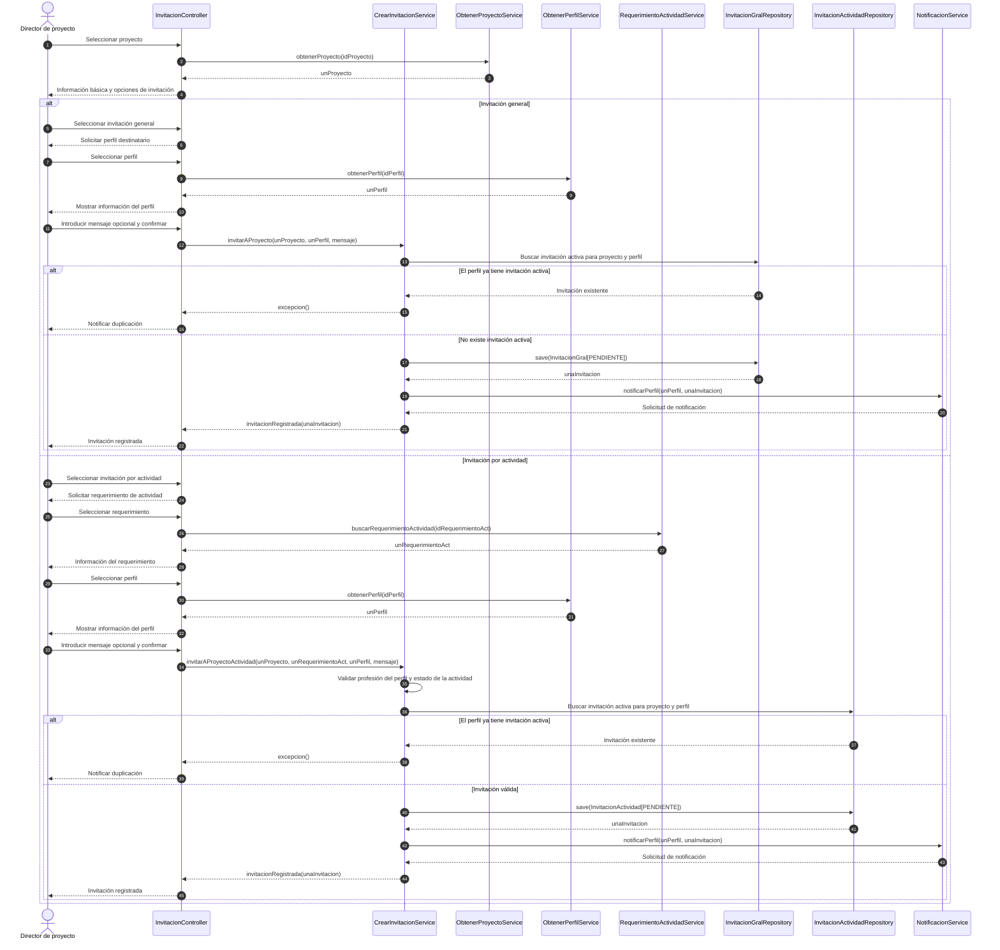

La invitación general se asocia directamente al proyecto: `InvitacionGral`
conserva `proyecto` y deja `requerimientoGral` opcional. La invitación por
actividad debe asociar el perfil destinatario, el perfil remitente, el
requerimiento de actividad, el mensaje y el estado `PENDIENTE`. La notificación
se dirige al perfil destinatario.

La búsqueda previa de requerimientos de actividad corresponde a UC-73 y se
expone mediante `GET /proyectos/{idProyecto}/requerimientos-actividad/buscar`,
con filtros opcionales por actividad, profesión, características y habilidades.

Para seleccionar varios perfiles en una sola acción se agregan:

```http
POST /proyectos/{idProyecto}/invitaciones/general/batch
POST /proyectos/{idProyecto}/invitaciones/actividad/batch
```

El servicio valida una vez el contexto común (perfil activo, proyecto,
permisos y, en actividad, requerimiento y estado) y luego procesa cada perfil
en una transacción independiente. La respuesta contiene `creadas[]` y
`errores[]`, permitiendo éxito parcial. Los IDs repetidos se deduplican.

## UC-70 — Asignar actividad a miembro

La asignación relaciona un `MiembroProyecto` activo con una `Actividad`.
Primero se obtiene el perfil y su usuario para verificar la disponibilidad
frente al rango factible de la actividad; solamente después de la confirmación
se persiste `AsignacionActividad`.

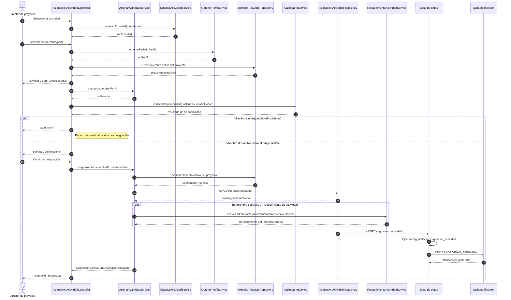

La operación `asignarActividad` debe ejecutarse dentro de una transacción:
la asignación y la actualización condicional del requerimiento forman parte
del mismo resultado de negocio. El trigger
`trg_notificar_asignacion_actividad` crea la notificación de tipo
`ACTIVIDAD_ASIGNADA` para el usuario y perfil del miembro insertado.

## UC-32 — Eliminar invitación a proyecto

El contrato de `darDeBajaInvitación` establece que la invitación debe estar en
estado `PENDIENTE`. Una vez confirmada la acción, se elimina el registro de la
invitación, no se lo transforma en un estado histórico alternativo.

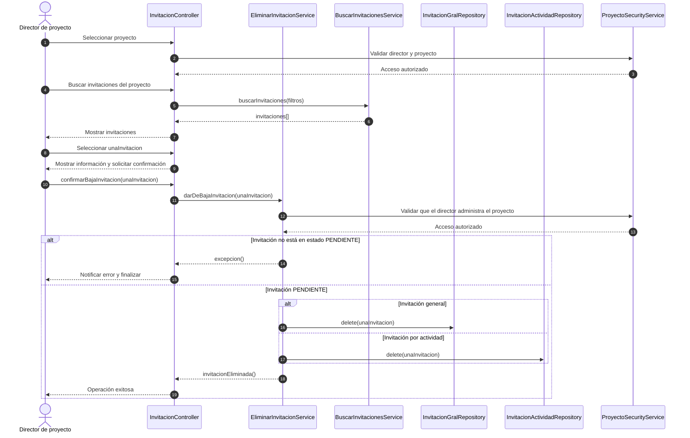

La eliminación debe ejecutarse dentro de una transacción y debe volver a
validar el estado de la invitación al confirmar la operación, para evitar
eliminar una invitación que haya sido aceptada o rechazada entre la consulta y
la confirmación.

La implementación expone dos endpoints `DELETE`, uno por tipo:

```http
DELETE /proyectos/{idProyecto}/invitaciones/general/{idInvitacion}
DELETE /proyectos/{idProyecto}/invitaciones/actividad/{idInvitacion}
```

Sólo el Director que envió la invitación puede eliminarla. El backend valida
`ELIMINAR_INVITACION`, rol Director activo, pertenencia al proyecto, remitente y
estado `PENDIENTE`. La fila se bloquea con `PESSIMISTIC_WRITE` para evitar
carreras con UC-28. El borrado es físico y no genera notificación. La respuesta
exitosa es `204 No Content`.

## UC-38 — Eliminar integrante

El director elimina a un integrante activo del proyecto. La baja se registra
como estado `ELIMINADO`, se guarda el motivo y la fecha de baja, y se conservan
las asignaciones para auditoría y trazabilidad. El profesional deja de contar
como recurso activo, por lo que cada actividad que pierde el recurso reabre la
vacante correspondiente por cálculo de cupo.

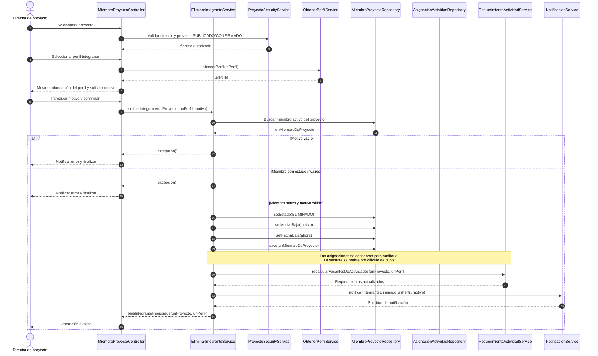

La implementación actual realiza una baja lógica: la membresía pasa a
`ELIMINADO` y conserva `motivoBaja` y `fechaBaja`. No se borran físicamente las
asignaciones; se conservan para auditoría. Las consultas operativas filtran
miembros `ACTIVO`, por lo que el profesional deja de contar como recurso y la
vacante se reabre por cálculo de cupo. El historial de actividad muestra a los
profesionales eliminados cuando la actividad está `EN_CURSO`, `FINALIZADA` o
`CANCELADA`; no los muestra en `PENDIENTE`. La notificación se dirige al perfil
eliminado.

## UC-40 — Darse de baja de proyecto

La baja voluntaria sigue el mismo criterio de baja lógica que UC-38: la
membresía pasa a `BAJA_VOLUNTARIA`, conserva `motivoBaja` y `fechaBaja`, y las
asignaciones a actividades no se borran; quedan como historial. La vacante se
reabre por cálculo de cupo porque las consultas operativas filtran miembros
activos. El actor es cualquier miembro activo, incluido un Director si queda al
menos otro Director activo. La notificación se dirige a los directores activos
restantes.

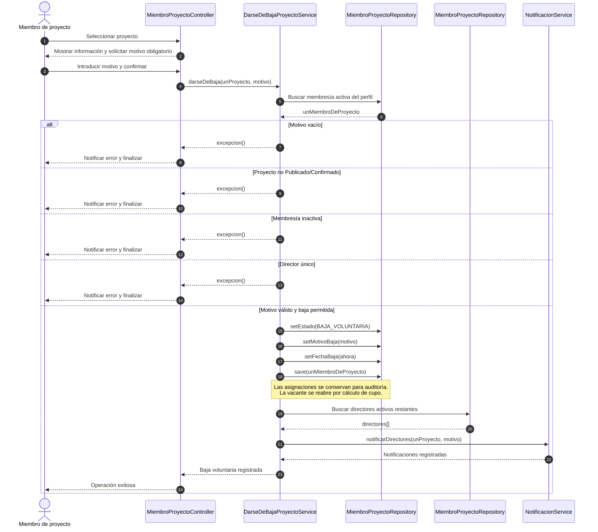

La operación es transaccional. No se borran asignaciones ni se recalcula el
cronograma. Si el proyecto está `CONFIRMADO`, las actividades conservan sus
fechas. El historial de actividades muestra a los profesionales con
`estadoParticipacion = BAJA_VOLUNTARIA` cuando la actividad está `EN_CURSO`,
`FINALIZADA` o `CANCELADA`; no los muestra en `PENDIENTE`.

## UC-09 — Autenticar mediante Google OAuth

**Implementación:** `GET /auth/google`, `GET /auth/google/pendiente` y
`POST /auth/google/completar`, atendidos por `AuthController` y
`GoogleAuthService`, con `usuario_identidad` como fuente de proveedores.

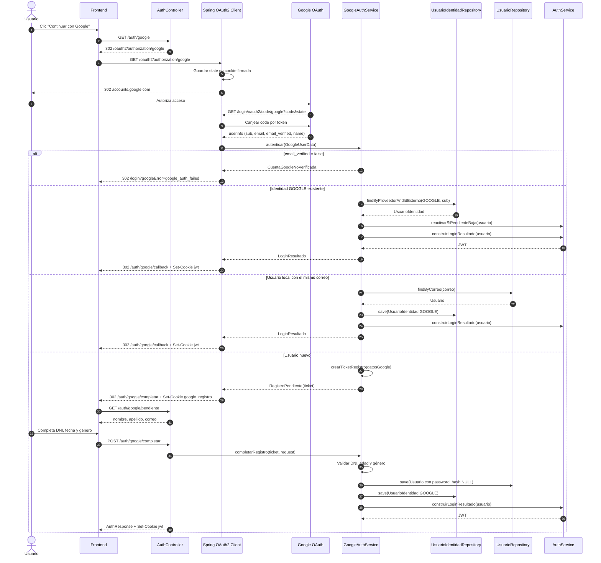

La cuenta canónica sigue siendo `usuario`; `usuario_identidad` solo resuelve
con qué proveedor se autenticó. El onboarding es obligatorio antes de crear la
cuenta para no relajar las restricciones de DNI, edad y género.

## UC-23 — Configurar términos y condiciones

**Implementación actual:** `GET/PUT /perfiles/{idPerfil}/terminos-condiciones`,
atendido por `PerfilTerminosCondicionesController` y
`GestionTerminosCondicionesService`.

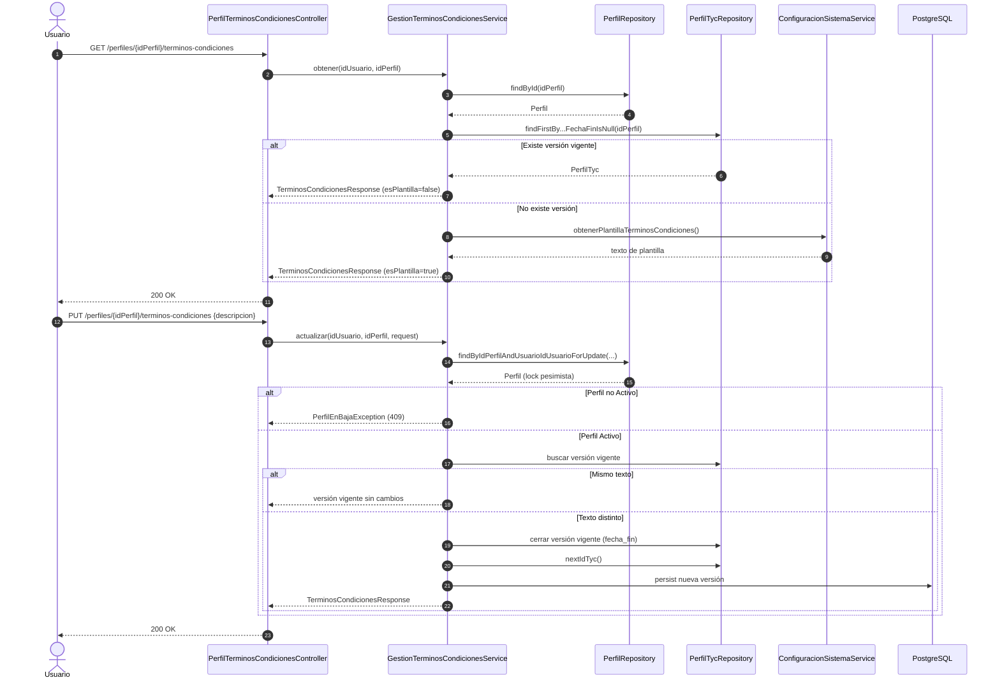

La versión vigente se incluye en `GET /perfiles/{idPerfil}`. Cuando un proyecto
incorpora al perfil, el director debe aceptar esa versión; el id aceptado se
guarda en `invitacion_gral.id_tyc_aceptado`,
`invitacion_actividad.id_tyc_aceptado` o
`miembros_proyecto.id_tyc_aceptado` según el flujo.