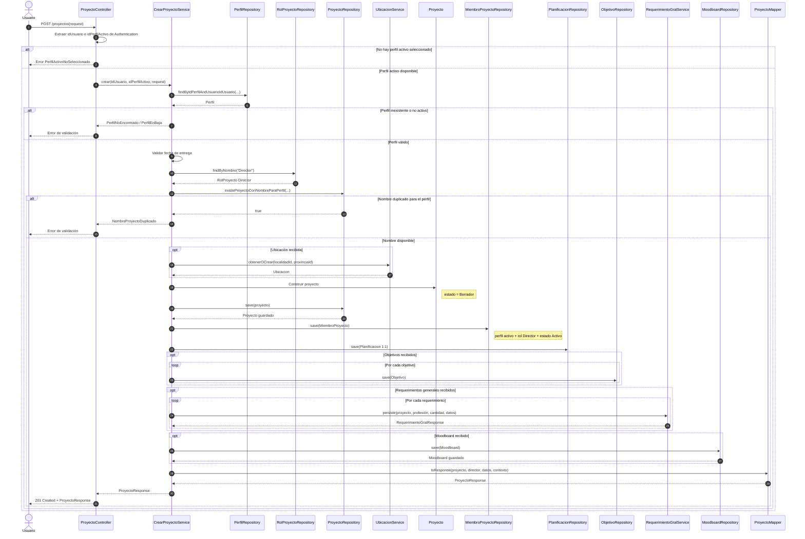
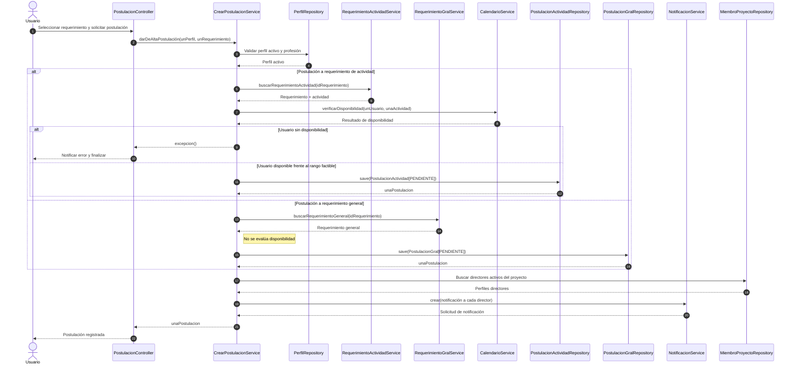
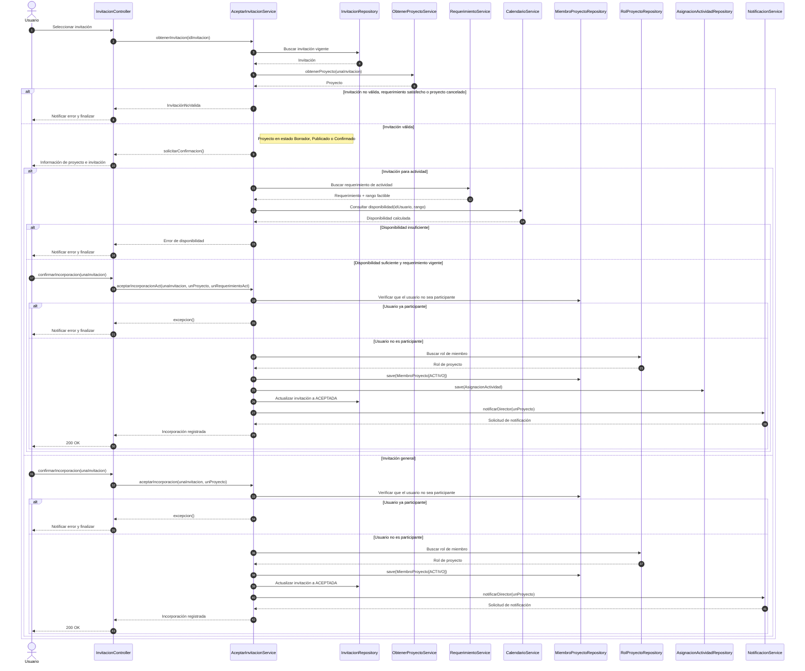
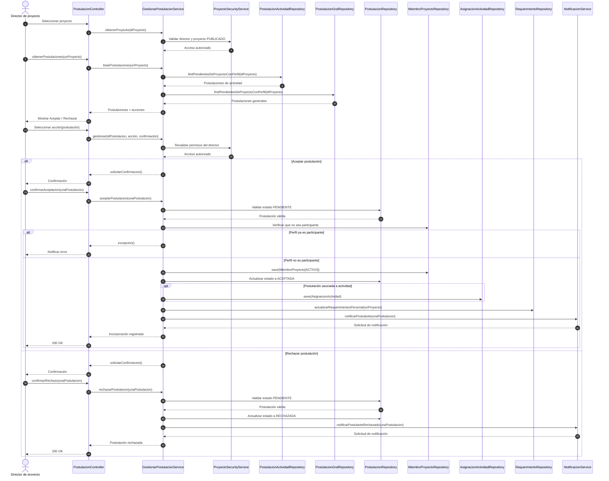
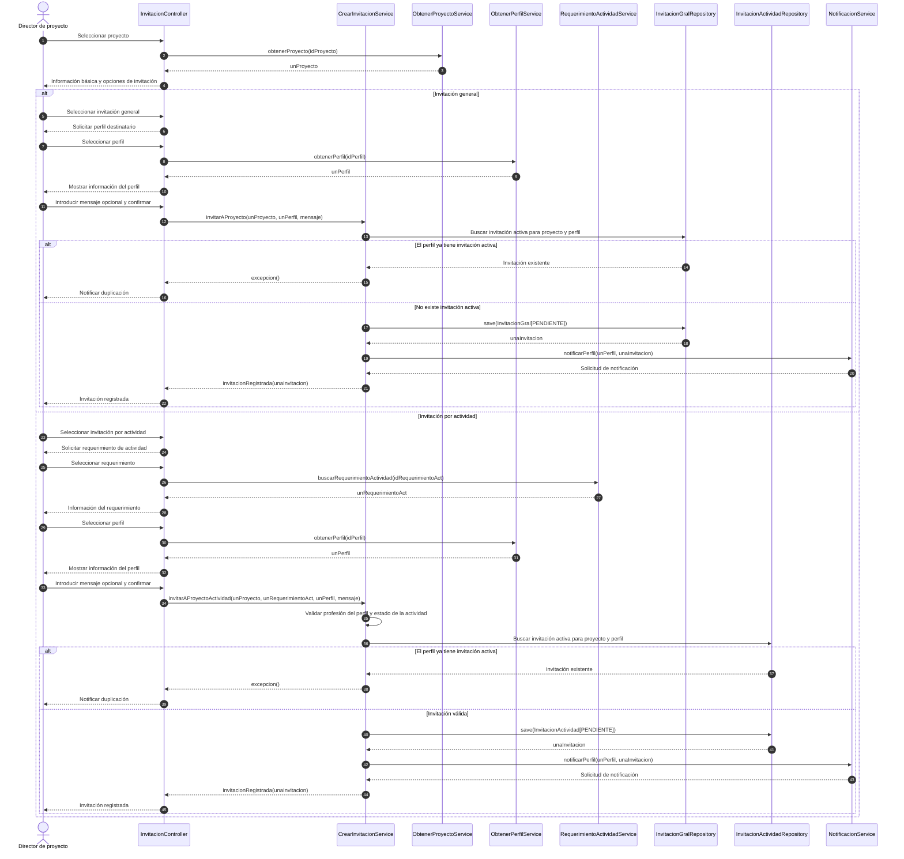
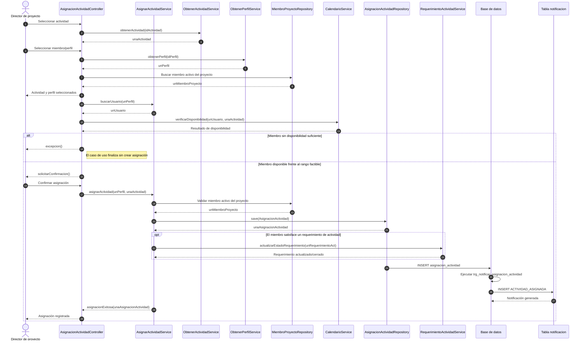
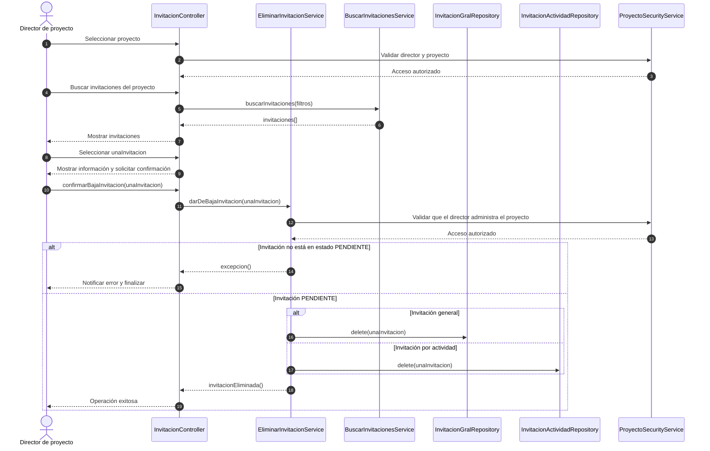
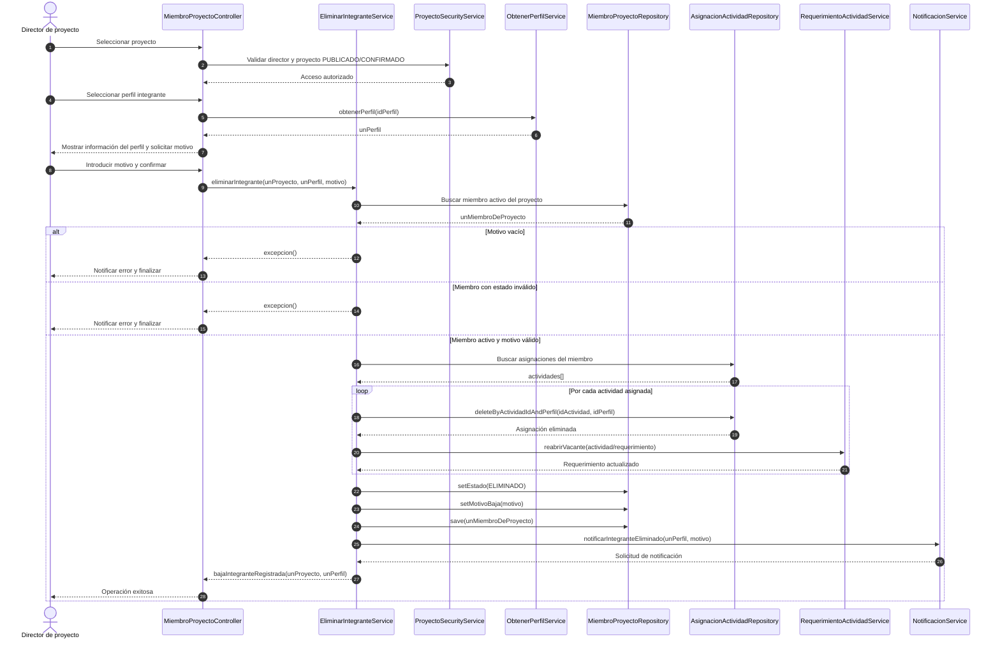
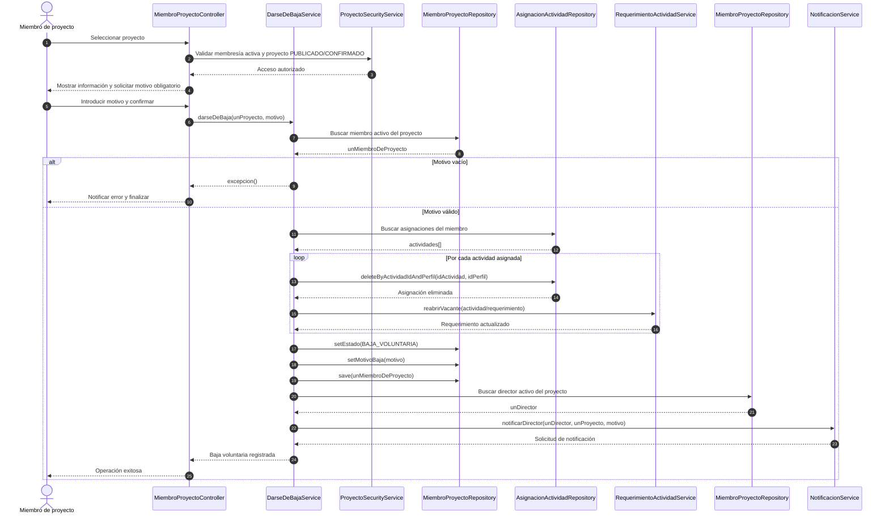

# Diagramas de secuencia de diseño

> **Alcance y criterio de lectura**
>
> Estos diagramas se elaboraron a partir de la estructura actual del backend y de
> `docs/3_diseño/ModaLinkBD.sql`.
>
> - **UC-24** refleja el flujo implementado actualmente.
> - **UC-26, UC-28 y UC-34** reflejan el diseño de los casos de uso a partir de
>   sus DSS, contratos y entidades persistentes. Los nombres de las capas de
>   aplicación se expresan según la responsabilidad que deben cumplir en el
>   diseño, independientemente de su estado de implementación.
> - La disponibilidad se calcula en backend mediante la agenda, bloqueos y
>   actividades existentes; no se trata como un dato persistido estático.

## UC-24 — Crear proyecto

**Implementación actual:** `POST /proyectos`, atendido por
`ProyectoController.crear` y `CrearProyectoService.crear`.

### Persistencia relevante de UC-24

La transacción crea o actualiza las siguientes relaciones:

1. `proyecto`, con estado `BORRADOR`.
2. `miembros_proyecto`, asociando el perfil activo al rol `DIRECTOR`.
3. `planificacion`, en relación 1:1 con el proyecto.
4. `objetivo`, si se enviaron objetivos.
5. `requerimiento_gral_proyecto` y sus características/habilidades, si se
   enviaron requerimientos.
6. `moodboard`, si se envió material de inspiración.

Los campos obligatorios del request son `nombre`, `descripcion` y `privacidad`.
La validación de Bean Validation ocurre antes de ingresar al servicio.

## UC-26 — Dar de alta postulación a proyecto

La postulación debe quedar inicialmente en estado `PENDIENTE`, asociada al
perfil y al requerimiento correspondiente. Se notifica a **todos** los
directores activos del proyecto con el tipo `POSTULACION_RECIBIDA`; la
notificación debe referenciar la postulación mediante `entidad_tipo` y
`entidad_id`.

Sólo los proyectos en estado `PUBLICADO` aceptan postulaciones (UC-60 los
cierra), el perfil debe estar activo, tener la profesión solicitada y no ser
miembro activo del proyecto. Un perfil no puede postularse dos veces al mismo
requerimiento (garantizado además por los índices únicos
`UQ_perfil_postulacion_act` / `UQ_perfil_postulacion_gral`). Sólo se admite
postular a actividades `PENDIENTE`.

La verificación de disponibilidad de UC-26 es **provisional**: mientras el
proyecto no tenga fecha de inicio confirmada se evalúa el rango
`[ahora, fecha de entrega]` en lugar del rango estricto `[ES, LF]` del CPM, y
la respuesta lo informa. La comprobación debe repetirse al confirmar el
proyecto (UC-60) y al asignar la actividad (UC-70).

Endpoints:

- `POST /proyectos/{idProyecto}/postulaciones/actividad` con
  `{ "idRequerimientoActividad": ... }`.
- `POST /proyectos/{idProyecto}/postulaciones/general` con
  `{ "idRequerimientoGral": ... }`.

## UC-28 — Aceptar solicitud de incorporación

La rama de actividad agrega la validación de disponibilidad y la asignación de
la actividad al miembro. La rama general no consulta disponibilidad porque no
asigna una actividad concreta. En ambas ramas se debe rechazar la operación si
el usuario ya es participante del proyecto.

## UC-34 — Gestionar postulaciones

### Reglas de persistencia y consistencia

- La aceptación debe crear un registro `miembros_proyecto` activo y actualizar
  el estado de la postulación en una única transacción.
- El estado de la postulación utiliza los valores del modelo:
  `PENDIENTE`, `ACEPTADA` o `RECHAZADA`.
- La base de datos ya contiene triggers para controlar cupos al aceptar
  postulaciones. El servicio debe propagar los errores de integridad y no
  devolver una aceptación exitosa si la transacción falla.
- El rechazo debe conservar la postulación con estado `RECHAZADA` para que
  pueda auditarse y generar la notificación correspondiente; el contrato de
  `rechazarPostulacion` no indica eliminarla.

## UC-31 — Invitar a proyecto

El caso de uso contempla una invitación general al proyecto y una invitación
asociada a un requerimiento de actividad. Ambas se almacenan con estado
`PENDIENTE`. La invitación por actividad además conserva la referencia al
requerimiento seleccionado.

La invitación por actividad debe asociar el perfil destinatario, el perfil
remitente, el requerimiento de actividad, el mensaje y el estado `PENDIENTE`.
La notificación se dirige al perfil destinatario.

## UC-70 — Asignar actividad a miembro

La asignación relaciona un `MiembroProyecto` activo con una `Actividad`.
Primero se obtiene el perfil y su usuario para verificar la disponibilidad
frente al rango factible de la actividad; solamente después de la confirmación
se persiste `AsignacionActividad`.

La operación `asignarActividad` debe ejecutarse dentro de una transacción:
la asignación y la actualización condicional del requerimiento forman parte
del mismo resultado de negocio. El trigger
`trg_notificar_asignacion_actividad` crea la notificación de tipo
`ACTIVIDAD_ASIGNADA` para el usuario y perfil del miembro insertado.

## UC-32 — Eliminar invitación a proyecto

El contrato de `darDeBajaInvitación` establece que la invitación debe estar en
estado `PENDIENTE`. Una vez confirmada la acción, se elimina el registro de la
invitación, no se lo transforma en un estado histórico alternativo.

La eliminación debe ejecutarse dentro de una transacción y debe volver a
validar el estado de la invitación al confirmar la operación, para evitar
eliminar una invitación que haya sido aceptada o rechazada entre la consulta y
la confirmación.

## UC-38 — Eliminar integrante

El director elimina a un integrante activo del proyecto. La baja se registra
como estado `ELIMINADO`, se guarda el motivo y se quitan las asignaciones del
miembro. Cada actividad que pierde el recurso debe volver a abrir la vacante
correspondiente.

El orden de la transacción garantiza que las asignaciones se eliminen y que
las vacantes se reabran antes de confirmar la baja del integrante. La
notificación se dirige al perfil eliminado.

## UC-40 — Darse de baja de proyecto

La baja voluntaria utiliza el mismo tratamiento de asignaciones que UC-38,
pero conserva la causa y cambia el estado de participación a
`BAJA_VOLUNTARIA`. El actor es el miembro que solicita su propia baja y la
notificación se dirige al director del proyecto.

La operación debe ser transaccional. En ambos casos de baja, la eliminación
de una asignación no elimina al miembro: primero se liberan los recursos
asignados y luego se actualiza el estado de participación. 