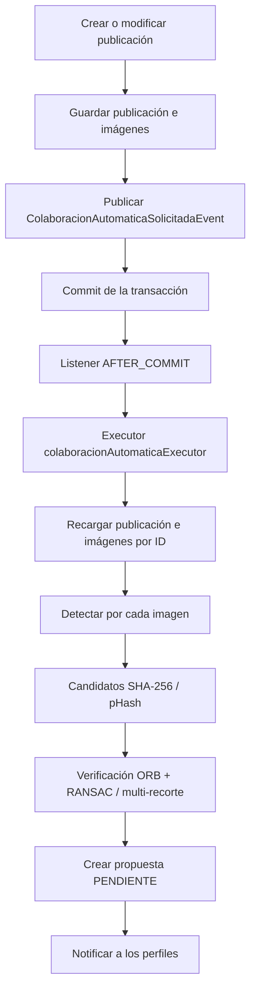
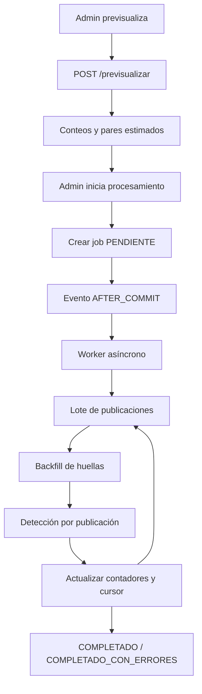

# Informe técnico — Proceso automatizado de colaboraciones automáticas

**Proyecto:** ModaLink Backend  
**Fecha:** 13/11/2026  
**Estado:** implementado y en funcionamiento  
**Alcance:** detección de imágenes compartidas, generación y gestión de propuestas, procesamiento histórico administrativo y contrato con el frontend.

---

## 1. Resumen ejecutivo

El proceso automatizado de colaboraciones detecta cuando dos publicaciones independientes comparten la misma imagen o una imagen visualmente muy similar, y genera una **propuesta de colaboración recíproca** que solo se activa cuando ambos dueños confirman.

Características principales:

- Detecta coincidencias exactas por **SHA-256** y perceptuales por **pHash**.
- Verifica candidatos con **ORB**, **ratio test de Lowe** y **homografía RANSAC**.
- Usa **pHash sobre múltiples recortes** como fallback para imágenes recortadas o reencuadradas.
- Persiste la evidencia y los scores de cada verificación.
- Ejecuta la detección de subidas en un **hilo aparte, después del commit**, para no penalizar la latencia.
- Permite **autocolaboración** entre perfiles del mismo usuario, sin permitir conexiones entre esos perfiles.
- Incluye un **procesamiento histórico masivo** desde el panel administrador, con job asíncrono, progreso, errores, cancelación y reanudación.
- Prioriza **precisión** sobre recall: prefiere no proponer antes que proponer una colaboración falsa.

---

## 2. Tecnologías y dependencias

### 2.1 Plataforma base

| Componente | Versión / tecnología | Uso |
|---|---|---|
| Lenguaje | Java 25 | Backend |
| Framework | Spring Boot 4.1.0 | Aplicación, DI, web, datos, seguridad |
| Build | Maven 3.9.x | Compilación y empaquetado |
| Persistencia | Spring Data JPA / Hibernate | Entidades y repositorios |
| Base de datos | PostgreSQL 17 | Producción y tests |
| Migraciones | SQL manual en `docs/3_diseño/migraciones/` | Cambios de esquema |
| Seguridad | Spring Security + JWT (JJWT 0.13.0) | Autenticación y roles |
| Asincronía | Spring `@Async`, `ThreadPoolTaskExecutor`, eventos transaccionales | Detección post-commit |
| Auditoría | Spring AOP + triggers PostgreSQL | Operador real en auditoría |
| Validación | Jakarta Validation | DTOs de entrada |
| Utilidades | Lombok | Getters/setters/builders |

### 2.2 Dependencias principales del backend

| Grupo / artefacto | Versión | Para qué |
|---|---|---|
| `spring-boot-starter-web` | 4.1.0 | API REST |
| `spring-boot-starter-data-jpa` | 4.1.0 | Persistencia |
| `spring-boot-starter-security` | 4.1.0 | Roles y permisos |
| `spring-boot-starter-oauth2-client` | 4.1.0 | Login con Google |
| `spring-boot-starter-mail` | 4.1.0 | Notificaciones por email |
| `spring-boot-starter-actuator` | 4.1.0 | Health / métricas |
| `spring-boot-starter-aspectj` | 4.1.0 | Auditoría por AOP |
| `spring-boot-starter-validation` | 4.1.0 | Validación de requests |
| `spring-boot-jackson2` | 4.1.0 | Serialización JSON |
| `postgresql` | administrada por Boot | Driver JDBC |
| `org.bytedeco:opencv` | 4.14.0-1.5.14 | pHash, ORB, BFMatcher, RANSAC |
| `org.bytedeco:javacpp` | 1.5.14 | Puente nativo de OpenCV |
| `org.bytedeco:openblas` | 0.3.34-1.5.14 | Álgebra nativa (perfiles) |
| `thumbnailator` | 0.4.20 | Redimensión de imágenes |
| `imageio-webp` (TwelveMonkeys) | 3.15.3 | Lectura WebP |
| `imageio-jpeg` (TwelveMonkeys) | 3.15.3 | Lectura JPEG |
| `webp-imageio` (Sejda) | 0.1.6 | Escritura WebP |
| `jjwt-api/impl/jackson` | 0.13.0 | Tokens JWT |
| `openpdf` | 3.0.5 | Exportación PDF de auditoría |
| `lombok` | administrada por Boot | Código boilerplate |

### 2.3 Dependencias de testing

| Dependencia | Versión | Uso |
|---|---|---|
| `spring-boot-starter-test` | 4.1.0 | JUnit 5, Mockito, AssertJ |
| `spring-boot-starter-webmvc-test` | 4.1.0 | Tests MVC |
| `spring-security-test` | 4.1.0 | Seguridad en tests |
| `spring-boot-testcontainers` | 4.1.0 | PostgreSQL real en tests |
| `testcontainers-bom` | 1.21.3 | Gestión de versiones |
| `testcontainers:junit-jupiter` | 1.21.3 | Integración JUnit |
| `testcontainers:postgresql` | 1.21.3 | Contenedor PostgreSQL 17-alpine |

### 2.4 Frontend relacionado

El frontend es una aplicación separada:

| Componente | Versión |
|---|---|
| Vue | 3.5.20 |
| Vue Router | 4.5.1 |
| Vuestic UI | 1.10.3 |
| Axios | 1.11.0 |
| Chart.js | 4.6.1 |
| Vite | 7.0.4 |
| Tailwind CSS | 4.3.3 |

Pantallas y servicios del módulo:

- `ColaboracionesAutomaticasHistoricasView.vue` — listado, filtros, previsualización e inicio de jobs.
- `ColaboracionAutomaticaHistoricaDetalleView.vue` — detalle, contadores, errores y cancelación.
- `adminColaboracionAutomaticaHistoricaService.js` — contrato HTTP.
- `colaboracionAutomaticaHistoricaConstants.js` — estados, modos, normalización y mensajes.

### 2.5 Perfiles nativos de OpenCV

El `pom.xml` activa dependencias nativas según el sistema operativo:

- `opencv-windows-x86_64`
- `opencv-linux-x86_64`

Incluyen los clasificadores nativos de OpenCV, JavaCPP y OpenBLAS. Esto permite usar pHash, ORB y RANSAC sin instalar OpenCV por separado.

---

## 3. Arquitectura del proceso

### 3.1 Flujo de una subida



La respuesta de subida no espera la detección. El request solo guarda y publica el evento; el trabajo corre en un hilo aparte después del commit.

### 3.2 Flujo histórico administrativo



### 3.3 Componentes principales

| Componente | Responsabilidad |
|---|---|
| `CrearPublicacionService` / `ModificarPublicacionService` | Guardan la publicación e imágenes y publican el evento de detección |
| `ColaboracionAutomaticaSolicitadaEvent` | Evento con IDs de publicación e imágenes |
| `ColaboracionAutomaticaEventoListener` | Escucha `AFTER_COMMIT` y encola el trabajo |
| `DetectarColaboracionAutomaticaAsyncService` | Recarga datos en una transacción nueva y llama al detector |
| `DetectarColaboracionAutomaticaService` | Pipeline de detección, candidatos, verificación y propuestas |
| `CoincidenciaVerificacionService` | ORB, ratio test, RANSAC y fallback multi-recorte |
| `HuellaImagenService` | SHA-256, pHash y distancia Hamming |
| `StorageService` | Lectura/escritura de archivos de imagen |
| `ColaboracionAutomaticaRepository` | Propuestas y consultas de pares/estados |
| `GestionarColaboracionAutomaticaService` | Confirmar/rechazar propuestas |
| `ColaboracionAutomaticaLifecycleService` | Cancelar/disolver por cambios en publicaciones o etiquetas |
| `ColaboradorPublicacionOrigenService` | Origen `MANUAL`, `AUTOMATICA` o `AMBOS` de cada etiqueta |
| `AdminColaboracionHistoricaService` | Previsualización, creación, listado, detalle, errores, cancelación y reanudación |
| `ProcesamientoHistoricoWorker` | Bucle asíncrono del job histórico |
| `ProcesamientoHistoricoBatchService` | Procesa lotes/publicaciones en transacciones cortas |
| `ProcesamientoHistoricoStartupService` | Marca jobs interrumpidos al reiniciar |
| `AsyncConfig` | Executors dedicados |

### 3.4 Executors asíncronos

| Executor | Core / max | Cola | Prefijo | Uso |
|---|---:|---:|---|---|
| `colaboracionAutomaticaExecutor` | 2 / 4 | 100 | `colab-auto-` | Detección de subidas |
| `procesamientoHistoricoExecutor` | 1 / 1 | 10 | `colab-hist-` | Job histórico masivo |

El executor histórico usa un solo hilo para no competir con las subidas ni saturar CPU/OpenCV.

---

## 4. Comportamiento de la detección

### 4.1 Disparo

La detección se dispara:

- al **crear** una publicación, con todas sus imágenes;
- al **modificar** una publicación, solo con las imágenes nuevas.

No se ejecuta dentro del request. El servicio publica un evento y el listener `@TransactionalEventListener(phase = AFTER_COMMIT)` encola el trabajo en el executor.

### 4.2 Filtro de candidatos

Para cada imagen se buscan candidatos en otras publicaciones:

1. **SHA-256 exacto** sobre `imagen.sha256_contenido`.
2. **pHash perceptual** con distancia de Hamming:

```sql
bit_count(CAST(i.phash AS bit(64)) # CAST(:phash AS bit(64))) <= 24
```

Se ordenan por distancia y se limitan a `max-propuestas-por-imagen` (10).

Exclusiones:

- la misma publicación;
- el mismo perfil;
- publicaciones no `ACTIVA`, perfiles no `ACTIVO` o usuarios no `ACTIVO`;
- publicaciones donde ya existe una etiqueta de colaborador;
- propuestas `PENDIENTE` o `CONFIRMADA` para el mismo par.

**Perfiles del mismo usuario:** se permiten. Solo se excluye el mismo perfil, no el mismo usuario.

### 4.3 Pipeline de verificación

```text
1. SHA-256 igual                    -> EXACTA
2. pHash <= 8 (alta confianza)      -> PERCEPTUAL_ALTA
3. ORB + ratio + RANSAC >= 10       -> PERCEPTUAL_ORB
4. Multi-recorte pHash <= 8         -> PERCEPTUAL_MULTICROP
5. Sin coincidencia                 -> se descarta
```

#### ORB + RANSAC

1. Se detectan keypoints y descriptores ORB en ambas imágenes.
2. Se exigen al menos `orb-min-keypoints` (50) en cada una.
3. Pre-filtro de rendimiento: matches cruzados con distancia Hamming `<= 60`.
   Se exigen al menos `orb-min-matches` (50).
4. **Ratio test de Lowe 0.75** con `knnMatch`:
   el mejor match debe ser claramente mejor que el segundo.
5. **Homografía con RANSAC** sobre los matches filtrados.
6. Se acepta si los **inliers geométricos** son `>= orb-min-inliers` (10).

El score `orb_inliers` que se persiste es el **inlier geométrico real**, no un proxy por distancia.

#### Fallback multi-recorte

Si ORB no alcanza:

- se generan recortes de ambas imágenes con grilla 3×3;
- escalas 90 %, 80 % y 70 %;
- se calcula pHash de cada recorte;
- se toma la distancia mínima entre recortes;
- se acepta si `<= multicrop-distancia-maxima` (8).

### 4.4 Persistencia de la propuesta

Tabla `colaboracion_automatica`:

| Campo | Uso |
|---|---|
| `id_colaboracion_automatica` | PK |
| `id_imagen` | Imagen de evidencia |
| `sha256_evidencia` | SHA-256 de la imagen |
| `phash_version` | Versión del algoritmo pHash |
| `distancia_phash` | Distancia pHash entre imágenes |
| `distancia_multicrop` | Distancia mínima del fallback |
| `orb_matches` | Matches ORB buenos (crossCheck) |
| `orb_inliers` | Inliers geométricos de RANSAC |
| `tipo_coincidencia` | `EXACTA`, `PERCEPTUAL_ALTA`, `PERCEPTUAL_ORB`, `PERCEPTUAL_MULTICROP` |
| `id_publicacion_a/b` | Par de publicaciones |
| `id_perfil_a/b` | Perfiles dueños |
| `estado` | `PENDIENTE`, `CONFIRMADA`, `RECHAZADA`, `CANCELADA`, `DISUELTA` |
| `estado_perfil_a/b` | `PENDIENTE`, `CONFIRMADA`, `RECHAZADA` |
| `fecha_deteccion` | Alta de la propuesta |
| `fecha_respuesta_a/b` | Respuesta de cada perfil |
| `fecha_confirmacion` | Confirmación final |
| `fecha_disolucion` | Disolución |

### 4.5 Confirmación y rechazo

- Cada dueño confirma o rechaza desde su perfil.
- La primera confirmación deja la propuesta `PENDIENTE`.
- La segunda confirmación:
  - agrega las etiquetas recíprocas de colaborador;
  - registra origen `AUTOMATICA` o `AMBOS`;
  - marca `CONFIRMADA`;
  - notifica a ambos.
- Un rechazo marca `RECHAZADA` y no agrega etiquetas.

**Autocolaboración:** si ambos perfiles pertenecen al mismo usuario, una sola confirmación o rechazo resuelve ambos lados. Se genera una sola notificación, en el contexto del perfil que subió la imagen.

### 4.6 Notificaciones

Tipos:

- `COLABORACION_AUTOMATICA_DETECTADA`
- `COLABORACION_AUTOMATICA_CONFIRMADA`
- `COLABORACION_AUTOMATICA_RECHAZADA`
- `COLABORACION_AUTOMATICA_CANCELADA`
- `COLABORACION_AUTOMATICA_DISUELTA`

Entidad: `COLABORACION_AUTOMATICA`.

En subidas normales se notifica a ambos perfiles. En autocolaboración se notifica una sola vez. En el procesamiento histórico `notificar` es `false` por defecto.

### 4.7 Ciclo de vida

| Situación | Resultado |
|---|---|
| Se elimina una publicación con propuesta pendiente | `CANCELADA`; se limpian notificaciones |
| Se elimina una publicación con colaboración confirmada | La otra publicación sigue existiendo; la propuesta conserva el registro |
| Se elimina una imagen con propuesta pendiente | `CANCELADA` |
| Un dueño se quita como colaborador | Se quita la etiqueta recíproca y la propuesta pasa a `DISUELTA` |
| Se quita una etiqueta manual | No afecta la colaboración automática |

### 4.8 Portfolio

El portfolio no cambia:

- publicaciones propias: siempre se incluyen;
- colaboraciones `MANUAL`: se incluyen;
- colaboraciones `AMBOS`: se incluyen;
- colaboraciones solo `AUTOMATICA`: se excluyen del portfolio.

La etiqueta del colaborador sí aparece dentro de la publicación del otro perfil.

### 4.9 Autocolaboración manual

Además del flujo automático:

- Las solicitudes manuales entre perfiles del mismo usuario ya no exigen conexión.
- Se agregó el etiquetado directo:

```http
POST /publicaciones/{idPublicacion}/colaboradores/propios
{ "idPerfil": 8 }
```

Agrega el perfil propio como colaborador con origen `MANUAL`, sin solicitud ni conexión.

- Las conexiones entre perfiles del mismo usuario siguen bloqueadas.
- El portfolio mantiene la regla anterior.

---

## 5. Procesamiento histórico administrativo

### 5.1 Objetivo

Procesar publicaciones e imágenes ya existentes para:

- completar huellas faltantes (`sha256_contenido`, `phash`);
- ejecutar la misma detección sobre publicaciones históricas;
- generar propuestas pendientes;
- hacerlo de forma asíncrona, observable e idempotente.

### 5.2 Modos

| Modo | Qué hace |
|---|---|
| `HUELLAS` | Solo calcula hashes faltantes |
| `DETECCION` | Solo detecta; omite imágenes sin pHash |
| `AMBOS` | Backfill y luego detección (recomendado) |

### 5.3 Endpoints

```http
POST /admin/colaboraciones-automaticas/historicas/previsualizar
POST /admin/colaboraciones-automaticas/historicas/procesar
GET  /admin/colaboraciones-automaticas/historicas
GET  /admin/colaboraciones-automaticas/historicas/{id}
GET  /admin/colaboraciones-automaticas/historicas/{id}/errores
POST /admin/colaboraciones-automaticas/historicas/{id}/cancelar
POST /admin/colaboraciones-automaticas/historicas/{id}/reanudar
```

Todos requieren rol `ADMINISTRADOR`.

### 5.4 Modelo del job

Tabla `procesamiento_colaboracion_historica`:

- estado, modo, filtros;
- `notificar`, `tamano_lote`, `limite_publicaciones`;
- contadores de publicaciones, imágenes, hashes, propuestas y errores;
- cursor `ultimo_id_publicacion`;
- usuario admin, fechas y mensaje de error.

Tabla `procesamiento_colaboracion_historica_error`:

- publicación, imagen, archivo, mensaje y fecha.

### 5.5 Estados

| Estado | Descripción |
|---|---|
| `PENDIENTE` | Job creado, esperando worker |
| `EN_PROGRESO` | Procesando lotes |
| `COMPLETADO` | Terminó sin errores |
| `COMPLETADO_CON_ERRORES` | Terminó con errores parciales |
| `CANCELADO` | Cancelado por el administrador |
| `FALLIDO` | Error fatal |
| `INTERRUMPIDO` | El servidor se reinició con el job en curso |

### 5.6 Ejecución

1. Se valida que no haya otro job activo.
2. Se crea el job en `PENDIENTE`.
3. Se publica `ProcesamientoHistoricoSolicitadoEvent`.
4. El listener `AFTER_COMMIT` encola el worker.
5. El worker marca `EN_PROGRESO`.
6. Procesa publicaciones con paginación por clave (`id_publicacion > ultimo_id`), en lotes.
7. Cada publicación se procesa en una transacción corta.
8. Se actualizan contadores y cursor.
9. Se registran errores por imagen sin abortar el job.
10. Al terminar: `COMPLETADO` o `COMPLETADO_CON_ERRORES`.
11. Al reiniciar: los jobs `PENDIENTE`/`EN_PROGRESO` pasan a `INTERRUMPIDO`.

### 5.7 Reanudación

`POST .../{id}/reanudar` crea un job nuevo con:

- los mismos filtros y modo;
- el mismo `notificar`, lote y límite;
- el cursor `ultimo_id_publicacion`;
- los contadores acumulados.

La detección es idempotente, por lo que reanudar no duplica propuestas.

### 5.8 Previsualización

Devuelve:

- publicaciones;
- imágenes;
- imágenes sin SHA-256;
- imágenes sin pHash;
- imágenes ilegibles (0 en preview; los errores reales se descubren al procesar);
- pares candidatos estimados.

### 5.9 Errores y auditoría

- Los errores por imagen se guardan en tabla propia.
- Un error individual no aborta el job.
- La ejecución, cancelación y reanudación se auditan con `@AuditarOperacion`.
- El evento de auditoría usa la entidad `procesamiento_colaboracion_historica`.

---

## 6. Base de datos

### 6.1 Tablas principales

| Tabla | Uso |
|---|---|
| `imagen` | Imágenes, `sha256_contenido`, `phash`, `phash_version` |
| `imagen_publicacion` | Relación imagen–publicación |
| `colaboracion_automatica` | Propuestas y scores |
| `colaborador_publicacion` | Etiquetas de colaborador |
| `colaborador_publicacion_origen` | Origen `MANUAL` / `AUTOMATICA` / `AMBOS` |
| `procesamiento_colaboracion_historica` | Job histórico |
| `procesamiento_colaboracion_historica_error` | Errores del job |

### 6.2 Migraciones

- `docs/3_diseño/migraciones/2026-11-11_colaboraciones_automaticas.sql`
- `docs/3_diseño/migraciones/2026-11-12_colaboraciones_automaticas_verificacion.sql`
- `docs/3_diseño/migraciones/2026-11-12_procesamiento_colaboraciones_historicas.sql`

Las migraciones no están versionadas por git; se aplican manualmente.

### 6.3 Esquema de tests

`src/test/resources/ModaLinkBD.sql` se usa con Testcontainers. El test base normaliza el script a LF y sin BOM en un archivo temporal y lo monta en `/docker-entrypoint-initdb.d` para evitar problemas de CRLF/BOM en Windows.

---

## 7. Configuración

```properties
app.colaboracion-automatica.habilitada=true
app.colaboracion-automatica.phash-distancia-candidato=24
app.colaboracion-automatica.phash-distancia-alta-confianza=8
app.colaboracion-automatica.max-propuestas-por-imagen=10

app.colaboracion-automatica.orb-min-keypoints=50
app.colaboracion-automatica.orb-min-matches=50
app.colaboracion-automatica.orb-max-distancia=60
app.colaboracion-automatica.orb-min-inliers=10

app.colaboracion-automatica.multicrop-distancia-maxima=8
app.colaboracion-automatica.multicrop-grid=3
app.colaboracion-automatica.multicrop-escalas=90,80,70

app.colaboracion-automatica.async.core-pool-size=2
app.colaboracion-automatica.async.max-pool-size=4
app.colaboracion-automatica.async.queue-capacity=100
app.colaboracion-automatica.async.thread-name-prefix=colab-auto-
app.colaboracion-automatica.async.await-termination-seconds=60

app.colaboracion-automatica.historico.queue-capacity=10
app.colaboracion-automatica.historico.await-termination-seconds=120
```

| Propiedad | Significado |
|---|---|
| `habilitada` | Activa/desactiva toda la detección |
| `phash-distancia-candidato` | Umbral máximo para considerar un candidato |
| `phash-distancia-alta-confianza` | Si pHash <= este valor, se acepta sin ORB |
| `max-propuestas-por-imagen` | Límite de candidatos por imagen |
| `orb-min-keypoints` | Keypoints mínimos por imagen |
| `orb-min-matches` | Matches ORB buenos mínimos antes de RANSAC |
| `orb-max-distancia` | Distancia Hamming máxima de un match bueno |
| `orb-min-inliers` | Inliers geométricos mínimos de RANSAC |
| `multicrop-distancia-maxima` | Distancia pHash máxima del fallback |
| `multicrop-grid` | Grilla de recortes |
| `multicrop-escalas` | Escalas de recorte |
| `async.*` | Pool de detección de subidas |
| `historico.*` | Cola del job histórico |

---

## 8. Rendimiento

Mediciones sobre pares reales (10 iteraciones, imágenes de ~500–1000 px):

| Etapa | Promedio |
|---|---|
| Decodificar 2 imágenes | 23–58 ms |
| ORB detectAndCompute (2) | 44–83 ms |
| BFMatcher crossCheck | 3–5 ms |
| `knnMatch` + ratio | 2–3 ms |
| RANSAC sobre matches filtrados | 1–2 ms |
| RANSAC sobre matches crudos | 1–85 ms |
| Multi-recorte pHash | 5–7 ms |

Conclusiones:

- La detección de subidas ya no bloquea el request: corre después del commit en `colaboracionAutomaticaExecutor`.
- RANSAC sobre matches filtrados por ratio agrega solo ~4–5 ms por candidato.
- El costo dominante sigue siendo decodificar + ORB.
- El job histórico usa un solo hilo y procesa aproximadamente 5–10 imágenes por segundo.
- El conteo de pares candidatos para la previsualización es O(N²); puede ser costoso con muchas imágenes.

---

## 9. Calidad y precisión

### 9.1 Muestra real

Se analizaron 32 imágenes reales de publicaciones y 423 pares comparables:

| Rango pHash | Pares | Resultado |
|---|---:|---|
| ≤ 8 | 3 | 3 verdaderos positivos |
| 9–16 | 0 | sin pares |
| 17–24 | 21 | falsos positivos con el ORB anterior |
| 25–32 | 218 | falsos positivos; el candidato 24 los excluye |

### 9.2 Separación con RANSAC

| Tipo | Inliers RANSAC |
|---|---|
| Verdaderos positivos | 314–500 |
| Falsos positivos | 0–5 |

Con `orb-min-inliers=10` los falsos quedan fuera y los verdaderos pasan.

### 9.3 Validación de un falso positivo real

Par “Producción Madoka” vs “mi primo naruto”:

```text
pHash: 24
Matches ORB <= 60: 57
Matches ratio: 5
Inliers RANSAC: 5
Multi-recorte: 17
```

Con la regla anterior (`matches >= 50`) se aceptaba. Con la regla actual:

- RANSAC 5 < 10 → ORB rechazado;
- multi-recorte 17 > 8 → rechazado.

El par ya no genera propuesta.

### 9.4 Duplicados exactos

Los pares con pHash 0 y `tipo_coincidencia = EXACTA` son el **mismo archivo** por SHA-256. Son verdaderos positivos por definición. Si no se desean, deben rechazarse manualmente.

---

## 10. Seguridad

- Endpoints de usuario: `hasRole('USUARIO')`.
- Endpoints administrativos: `/admin/**` con `hasRole('ADMINISTRADOR')`.
- El etiquetado directo de perfiles propios requiere `USUARIO`.
- El procesamiento histórico requiere `ADMINISTRADOR`.
- La auditoría registra el operador real con `@AuditarOperacion`.
- Las conexiones entre perfiles del mismo usuario siguen bloqueadas.

---

## 11. Pruebas

### 11.1 Tests del detector

- `CoincidenciaVerificacionServiceTest`
- `DetectarColaboracionAutomaticaServiceTest`
- `DetectarColaboracionAutomaticaAsyncServiceTest`
- `ColaboracionAutomaticaEventoIntegrationTest`

### 11.2 Tests de colaboración y autocolaboración

- `GestionarColaboracionAutomaticaServiceTest`
- `EnviarSolicitudColaboracionServiceTest`
- `AgregarColaboradorPropioServiceTest`
- `BuscarSolicitudColaboracionIntegrationTest`
- `ModificarPublicacionIntegrationTest`
- `EliminarPublicacionIntegrationTest`

### 11.3 Tests del procesamiento histórico

- `AdminColaboracionHistoricaServiceTest`
- `ProcesamientoHistoricoBatchServiceTest`
- `ProcesamientoHistoricoWorkerTest`
- `AdminColaboracionHistoricaControllerTest`
- `AdminColaboracionHistoricaLocalIntegrationTest`

### 11.4 Comandos

```powershell
mvn -q -DskipTests test-compile
mvn -q "-Dtest=CoincidenciaVerificacionServiceTest,DetectarColaboracionAutomaticaServiceTest" test
mvn -q "-Dtest=AdminColaboracionHistoricaServiceTest,ProcesamientoHistoricoBatchServiceTest,ProcesamientoHistoricoWorkerTest,AdminColaboracionHistoricaControllerTest" test
mvn -q -DskipTests package
```

Los tests de integración usan PostgreSQL real con Testcontainers.

---

## 12. Limitaciones y próximos pasos

1. **Propuestas falsas existentes:** las generadas antes del ajuste de RANSAC siguen pendientes. Deben rechazarse manualmente.
2. **Frontend:** faltan botones para “Reanudar” y para el etiquetado directo de perfiles propios. El backend ya expone ambos endpoints.
3. **Previsualización:** `imagenesIlegibles` se informa como 0; los errores reales se detectan durante el procesamiento.
4. **Escala del pHash:** el conteo de pares candidatos es O(N²). Para volúmenes grandes conviene evaluar bucketing o índices especializados.
5. **Migraciones:** no están versionadas; deben aplicarse manualmente en cada entorno.
6. **Calibración:** la muestra real es chica; conviene ampliarla con más positivos y negativos difíciles.
7. **Concurrencia del job:** el control de “un job activo” es una validación de servicio; si se necesita garantía estricta, agregar un índice único parcial.
8. **Reintentos/outbox:** si se requiere garantía de entrega ante caídas, evaluar un patrón outbox.

---

## 13. Referencias

- `docs/frontend/ficha-tecnica-colaboraciones-automaticas.md`
- `docs/frontend/ficha-tecnica-colaboraciones-automaticas-historicas.md`
- `docs/planes/plan-colaboraciones-automaticas-verificacion.md`
- `docs/3_diseño/migraciones/2026-11-11_colaboraciones_automaticas.sql`
- `docs/3_diseño/migraciones/2026-11-12_colaboraciones_automaticas_verificacion.sql`
- `docs/3_diseño/migraciones/2026-11-12_procesamiento_colaboraciones_historicas.sql`
- `src/main/java/org/mgroko/backend/publicaciones/servicio/CoincidenciaVerificacionService.java`
- `src/main/java/org/mgroko/backend/publicaciones/servicio/DetectarColaboracionAutomaticaService.java`
- `src/main/java/org/mgroko/backend/admin/servicio/AdminColaboracionHistoricaService.java`
- `src/main/java/org/mgroko/backend/admin/servicio/ProcesamientoHistoricoBatchService.java`
