# Informe Integral de Testing — ModaLink Backend

> **Ubicación:** `docs/6_presentaciones/tests.md`  
> **Proyecto:** ModaLink Backend (Spring Boot 4.1.0 / Java 25)  
> **Ámbito:** Análisis exhaustivo de `src/test`, tipología de pruebas, tecnologías, distribución por módulo, detección de brechas (tests faltantes) y propuestas de mejora.  
> **Última actualización:** 16/11/2026, sobre el commit `122817c`.  
> **Método:** Análisis estático del árbol de fuentes (conteo de clases y anotaciones `@Test`, `@ParameterizedTest`, `@WebMvcTest`, `@SpringBootTest`, `@Transactional`, etc.) y contraste con `src/main/java`. No se re-ejecutó la suite completa durante esta actualización.

---

## 1. Introducción y Contexto

En el marco del desarrollo de **ModaLink** y bajo los lineamientos metodológicos del **Proceso Unificado (UP)**, la estrategia de aseguramiento de calidad (QA) y verificación de software adopta un enfoque piramidal y riguroso. Cada módulo funcional del sistema cuenta con pruebas automatizadas orientadas a garantizar:

1. **Doble Capa de Validación**: comprobación tanto en la capa de transporte/controladores (Bean Validation) y lógica de aplicación/dominio (servicios Java con excepciones semánticas), como en la persistencia relacional (constraints, checks y triggers en PostgreSQL).
2. **Robustez ante Fallos**: cobertura sistemática de caminos felices (2xx) y caminos de error (4xx / excepciones de negocio) con verificación explícita de no-persistencia mediante `verify(repo, never()).save(...)`.
3. **Aislamiento y Trazabilidad**: diferenciación precisa entre pruebas puras de lógica en memoria, pruebas de integración web sin servidor completo, y pruebas de integración profunda con base de datos real en contenedores.
4. **Cobertura de Reglas Complejas**: además del CRUD, se prueban algoritmos de negocio propios (CPM de cronogramas, cálculo de disponibilidad, matching de reemplazos, pHash de imágenes, políticas de baja y cupos).

### 1.1. Cifras clave del estado actual

| Métrica | Valor |
| :--- | ---: |
| Archivos Java en `src/test` | **385** |
| Clases de prueba ejecutables | **383** |
| Clases base abstractas de infraestructura | **2** |
| Métodos de prueba (`@Test` / `@ParameterizedTest` / `@RepeatedTest`) | **2.973** |
| Clases `*ServiceTest` (unitarias de servicio) | **158** |
| Clases `*ControllerTest` (slice web) | **54** |
| Clases `*ValidationTest` (DTOs) | **21** |
| Clases `*MapperTest` | **12** |
| Archivos en `repositorio/` (integración PostgreSQL) | **90** (529 métodos) |
| Paquetes de producción con pruebas | **27 de 28** |
| Invocaciones a `assertThat(...)` (AssertJ) | **3.095** |
| Verificaciones Mockito (`verify(...)`) | **1.038** |
| Verificaciones de no-persistencia (`never()`) | **467** |
| Capturas con `ArgumentCaptor` | **216** |
| Aserciones `jsonPath(...)` en MockMvc | **775** |

> **Lectura:** el proyecto pasó de una suite acotada a una suite de escala industrial (~3.000 casos), con un bloque muy fuerte de integración real contra PostgreSQL y una red de pruebas de controlador que cubre prácticamente todos los endpoints.

---

## 2. Tecnologías y Herramientas del Stack de Testing

El proyecto aprovecha las capacidades de **Java 25** y **Spring Boot 4.1.0**, articulando el siguiente conjunto de dependencias y utilidades:

| Herramienta / Framework | Versión / Ámbito | Rol y Utilidad en ModaLink |
| :--- | :--- | :--- |
| **JUnit 5 (Jupiter)** | `junit-jupiter` (BOM de Spring Boot 4.1.0) | Motor estándar de ejecución (`@Test`, `@BeforeEach`, `@DisplayName`, `assertThrows`, `assertAll`). |
| **Mockito** | 5.x (`mockito-junit-jupiter`, BOM de Spring Boot) | Aislamiento y dobles de prueba (`@Mock`, `@InjectMocks`, `@MockitoBean`, `ArgumentCaptor`, `verify`, `never`). Permite probar servicios sin acoplamiento a I/O. |
| **Spring Boot Test** | `spring-boot-starter-test` | Contexto de pruebas de Spring, inyección de dependencias y utilidades de testing. |
| **Spring WebMvc Test & MockMvc** | `spring-boot-starter-webmvc-test` | Pruebas de integración de capa web (`@WebMvcTest`, paquete `org.springframework.boot.webmvc.test.autoconfigure`). Valida serialización JSON, códigos HTTP, `@Valid`, cookies y cabeceras sin levantar el servidor. |
| **Spring Security Test** | `spring-security-test` | Simulación de identidades con `SecurityMockMvcRequestPostProcessors` (`user(...)`, `authentication(...)`), pruebas de áreas protegidas y de logout con filtros activos. |
| **Jakarta Bean Validation** | `jakarta.validation` | Validador puro (`Validation.buildDefaultValidatorFactory().getValidator()`) para pruebas ultrarrápidas de DTOs sin contexto de Spring. |
| **Testcontainers** | 1.21.3 (`testcontainers-bom`) | Contenedor **singleton** de **PostgreSQL 17 Alpine** compartido por las pruebas de integración; contenedor adicional de **Mailpit** (`axllent/mailpit:latest`) para correo real. |
| **AssertJ** | BOM de Spring Boot | Aserciones semánticas encadenadas (`assertThat(...)`), predominantes en la suite. |
| **Jackson ObjectMapper** | `spring-boot-jackson2` | Serialización de DTOs de request a JSON en pruebas con MockMvc y parseo de respuestas. |
| **JaCoCo** | `jacoco-maven-plugin` 0.8.14 | Agente `prepare-agent` + reporte en fase `test` (`target/site/jacoco/index.html`). Configurado como **reporte**, sin objetivo `check` ni umbral mínimo. |
| **Maven Surefire** | `maven-surefire-plugin` | Ejecutor único de la suite. Configura `--enable-native-access=ALL-UNNAMED` en `argLine` para las librerías nativas de OpenCV. **No se usa failsafe.** |
| **Thumbnailator / ImageIO / WebP** | 0.4.20 / 3.15.3 / 0.1.6 | Pruebas reales de procesamiento de imágenes (conversión WebP, transparencias, redimensionado). |
| **OpenCV + JavaCPP** | 4.14.0-1.5.14 | Pruebas de huella perceptual (`pHash`) y detección de imágenes duplicadas. |

> **Corrección respecto de versiones anteriores del informe:** el proyecto **no utiliza Flyway ni Liquibase**. El esquema de la base de pruebas se inicializa copiando `src/test/resources/ModaLinkBD.sql` al `docker-entrypoint-initdb.d` del contenedor PostgreSQL. Las migraciones evolutivas se prueban de forma puntual con scripts en `src/test/resources/migraciones-test/`.

---

## 3. Tipología de Tests en el Proyecto

El repositorio `src/test` implementa una clasificación estandarizada en cinco grandes categorías:

```mermaid
graph TD
    A[Estrategia de Testing ModaLink] --> B[1. Unitarios Puros]
    A --> C[2. Slice Web / MockMvc]
    A --> D[3. Integración Real con PostgreSQL]
    A --> E[4. Eventos, Schedulers y SSE]
    A --> F[5. Rendimiento / Carga]

    B --> B1[Validación de DTOs - Jakarta]
    B --> B2[Servicios - MockitoExtension]
    B --> B3[Mappers - Java puro]
    B --> B4[Algoritmos: CPM, disponibilidad, matching]
    B --> B5[Seguridad y criptografía - JWT]
    B --> B6[Storage e imágenes - WebP / pHash]

    C --> C1[Controladores REST - @WebMvcTest]
    C --> C2[Filtros JWT, cookies y logout]
    C --> C3[Áreas protegidas admin/usuario/polaroids]

    D --> D1[Repositorios y consultas JPQL/nativas]
    D --> D2[Servicios end-to-end con @SpringBootTest]
    D --> D3[Constraints, checks y triggers de PostgreSQL]
    D --> D4[Concurrencia y bloqueos]
    D --> D5[Correo real con Mailpit]
    D --> D6[Idempotencia de migraciones SQL]

    E --> E1[Listeners de notificaciones y eventos]
    E --> E2[Schedulers de baja, limpieza y reconciliación]
    E --> E3[Buses SSE de mensajería y presencia]

    F --> F1[AuditoriaPerformanceIT - 100k registros, p95]
```



### 3.1. Tests Unitarios (Unit Tests)

Prueban componentes aislados en memoria, sin levantar el contenedor de Spring ni tocar la base de datos:

- **Validación de DTOs (`*ValidationTest`, 21 clases):**
  - *Mecanismo*: API de Jakarta Validation directamente.
  - *Objetivo*: evaluar `@NotNull`, `@NotBlank`, `@Size`, `@Min`, `@Max`, `@Pattern`, `@Email`, validaciones en cascada y formatos (por ejemplo, color `#RRGGBB`).
  - *Ejemplos*: `AuthDTOValidationTest`, `CrearPerfilDTOValidationTest`, `EditarPerfilDTOValidationTest`, `TerminosCondicionesDTOValidationTest`, `ConfigurarSchedulerRequestValidationTest`, `DatosPersonalesDTOValidationTest`, `DarseDeBajaProyectoRequestValidationTest`.
- **Servicios de Aplicación (`*ServiceTest`, 158 clases):**
  - *Mecanismo*: `@ExtendWith(MockitoExtension.class)`, dependencias con `@Mock` y clase evaluada con `@InjectMocks`.
  - *Objetivo*: reglas de negocio, cómputos, transiciones de estado, excepciones semánticas y verificación con `ArgumentCaptor` de los datos exactos que se pretendían guardar.
  - *Ejemplos*: `AuthServiceTest`, `CrearPerfilServiceTest`, `AdminUsuarioServiceTest`, `RechazoAutomaticoCupoServiceTest`, `ReprogramarProyectoServiceTest`, `CrearPostulacionServiceTest`, `CronogramaServiceTest`.
- **Mappers (`*MapperTest`, 12 clases):**
  - *Mecanismo*: Java puro, invocación directa.
  - *Objetivo*: transformación bidireccional Entidad ↔ DTO, listas vacías, campos nulos y ordenamientos.
  - *Ejemplos*: `UsuarioMapperTest`, `PerfilMapperTest`, `CalendarioMapperTest`, `AdminUsuarioMapperTest`, `PublicacionMapperTest`, `SolicitudColaboracionMapperTest`, `NotificacionMapperTest`, `UbicacionMapperTest`.
- **Algoritmos y reglas puras:**
  - `CpmMotorTest`: ruta crítica, holguras y márgenes del cronograma.
  - `DisponibilidadCalculatorTest`, `CalendarioDisponibilidadTest`, `CalendarioVentanaDisponibleTest`: cálculo de ventanas y solapamientos.
  - `EvaluadorConcordanciaTest`: puntuación de candidatos para reemplazos.
  - `BajaVoluntariaProyectoPolicyTest`, `ActividadEstadoValidatorTest`, `OrigenInicioResolverTest`.
  - `LikePatronesTest`, `CodigoHabilidadTest`: utilidades transversales.
- **Seguridad y criptografía:**
  - `JwtServiceTest` (firma HS256, expiración, tokens alterados), `JwtCookieFactoryTest` (cookies `httpOnly`), `JwtAuthenticationFilterTest`, `SecurityConfigTest`.
- **Storage y procesamiento de imágenes:**
  - `LocalStorageServiceTest` (I/O en directorios temporales), `ProcesadorImagenTest` (WebP, alfa, relación de aspecto), `HuellaImagenServiceTest` (SHA-256 y pHash), `BorradoArchivosDiferidoTest`.

### 3.2. Tests Mixtos / Slice Tests (Corte de Capa Web)

Prueban la interacción de varias piezas dentro de un corte controlado del framework:

- **Controladores Web (`*ControllerTest`, 54 clases; 58 usos de `@WebMvcTest`):**
  - *Mecanismo*: `@WebMvcTest(controllers = ...)` y, en la mayoría de los casos, `@AutoConfigureMockMvc(addFilters = false)`. Los servicios colaboradores se inyectan como `@MockitoBean` (186 usos).
  - *Naturaleza Mixta*: combina enrutamiento HTTP, serialización Jackson, validación `@Valid` y `GlobalExceptionHandler`, mientras la lógica de negocio queda mockeada.
  - *Objetivo*: verificar status (`200`, `201`, `204`, `400`, `401`, `403`, `404`, `409`), cuerpo JSON con `jsonPath(...)` y ausencia de efectos colaterales.
  - *Ejemplos*: `AuthControllerTest`, `PerfilControllerTest`, `ProyectoControllerTest`, `PostulacionControllerTest`, `CalendarioControllerTest`, `AdminPublicacionControllerTest` y `AdminCaracteristicaTecnicaControllerTest`.
- **Seguridad a nivel de filtros:**
  - `AdminAreaAccessSecurityTest`: con `@Import(SecurityConfig.class)` verifica que un usuario común reciba `403` en el panel admin y que el administrador no acceda al dashboard de usuario.
  - `PolaroidAreaAccessSecurityTest`: restringe el área de polaroids.
  - `LogoutSecurityIntegrationTest`: único test con `@AutoConfigureMockMvc(addFilters = true)`, valida revocación de cookie y `SecurityContextHolder`.
- **Filtros y flujos de sesión:** `JwtAuthenticationFilterTest`, `LogoutIntegrationTest`.

### 3.3. Tests de Integración (Integration Tests)

Prueban la integración total entre componentes y la infraestructura real de almacenamiento persistente:

- **Infraestructura (90 archivos, 529 métodos):**
  - `AbstractPostgresIntegrationTest`: contenedor **singleton** `postgres:17-alpine`, arrancado una sola vez por JVM y compartido por Spring. Copia `ModaLinkBD.sql` normalizando CRLF/BOM (compatibilidad Windows/OneDrive).
  - `AbstractFirmaContratoIntegrationTest`: fixture compartido del caso de uso de firma de contratos.
  - 87 clases concretas heredan la base; `NotificacionEmailMailpitIntegrationTest` gestiona su propio PostgreSQL + Mailpit.
  - Uso intensivo de `@SpringBootTest` (88 clases), `@Transactional` (96 usos) y `JdbcTemplate`/`EntityManager` para inspeccionar el estado real.
- **Repositorios y reglas de persistencia (`*RepositoryIntegrationTest`, 10 clases):**
  - *Objetivo*: dialecto PostgreSQL, constraints compuestas, unicidad, `JOIN FETCH`, proyecciones y consultas derivadas.
  - *Ejemplos*: `UsuarioRepositoryIntegrationTest`, `CalendarioRepositoryIntegrationTest`, `CaracteristicaTecnicaRepositoryIntegrationTest`, `HabilidadRepositoryIntegrationTest`, `ValorCaracteristicaRepositoryIntegrationTest`, `ReemplazoRepositoryIntegrationTest`.
- **Servicios end-to-end con BD:**
  - `EditarPerfilServiceIntegrationTest`, `GenerarReemplazosIntegrationTest`, `CrearPostulacionIntegrationTest`, `ConfirmarProyectoIntegrationTest`, `FinalizarProyectoIntegrationTest`, `DarseDeBajaProyectoIntegrationTest`, `FirmarContratoIntegrationTest`, `ModificarContratoIntegrationTest`, `InteractuarPublicacionIntegrationTest`.
- **Reglas de base de datos (triggers y constraints):**
  - `AuditoriaTriggerIntegrationTest`, `CaracteristicaTecnicaEnUsoTriggerIntegrationTest`, `ContratoModificacionTriggerIntegrationTest`, `FotoPerfilAtomicidadIntegrationTest`, `SnapshotBajaIntegrationTest`.
- **Concurrencia:**
  - `EliminarConexionConcurrencyIntegrationTest`, `EliminarPublicacionConcurrencyIntegrationTest`, `GestionarPostulacionConcurrencyIntegrationTest`, `GestionarSolicitudConexionConcurrencyIntegrationTest` (uso de `CountDownLatch` y `ExecutorService`).
- **Correo real y OAuth:**
  - `NotificacionEmailMailpitIntegrationTest` (SMTP real + API HTTP de Mailpit), `NotificacionEmailOutboxIntegrationTest`, `GoogleOAuthFlowIntegrationTest`.
- **Migraciones SQL:**
  - `AuditoriaMigracionIdempotenciaTest`: aplica dos veces los scripts de `migraciones-test/` y verifica idempotencia.

### 3.4. Tests de Eventos, Schedulers y SSE

- **Listeners de notificaciones:** `ActividadEliminadaNotificacionListenerTest`, `ActividadModificadaNotificacionListenerTest`, `HabilidadEliminadaNotificacionListenerTest`, `HabilidadModificadaNotificacionListenerTest`, `ProyectoFinalizadoNotificacionListenerTest`, `ReportePerfilNotificacionListenerTest`, `ReportePublicacionNotificacionListenerTest`.
- **Schedulers:** `BajaSchedulerTest`, `DeshabilitacionSchedulerTest`, `LimpiezaImagenesSchedulerTest`, `MensajeriaSchedulerTest`, `PresenciaSchedulerTest`, `ReconciliacionCronogramaSchedulerTest`, `NotificacionEmailSchedulerTest`.
- **SSE:** `SseMensajeEventBusTest`, `SsePresenciaEventBusTest`, `PresenciaRegistryTest`, `PresenciaActividadListenerTest`, `MensajeEventoListenerTest`.
- **Histórico y limpieza:** `ProcesamientoHistoricoBatchServiceTest`, `ProcesamientoHistoricoWorkerTest`, `AdminColaboracionHistoricaServiceTest`.

### 3.5. Pruebas de Rendimiento

- `AuditoriaPerformanceIT` (`@Tag("performance")`): siembra 100.000 eventos y exige **p95 < 2 s** para una consulta de 30 días con 3 tipos.
- **Importante:** el nombre termina en `IT`, por lo que **Surefire no lo ejecuta con `mvn test`**. Se corre manualmente con `mvn -Dtest=AuditoriaPerformanceIT test`.

---

## 4. Estructura y Distribución Actual de Tests en el Proyecto

El directorio `src/test` cuenta con **385 archivos** (383 clases ejecutables + 2 bases abstractas), distribuidos en 27 paquetes:

| Módulo | Archivos | Métodos | Foco principal |
| :--- | ---: | ---: | :--- |
| `repositorio` | 90 | 529 | Integración PostgreSQL, triggers, concurrencia, Mailpit, OAuth, performance |
| `proyectos` | 40 | 380 | Proyecto, miembros, requerimientos, cupos, reprogramación, moodboard, calificaciones |
| `admin` | 41 | 346 | Configuración, usuarios, catálogos, reportes, histórico, schedulers |
| `actividades` | 26 | 233 | Actividades, cronograma/CPM, asignaciones, disponibilidad, requerimientos |
| `publicaciones` | 33 | 226 | Feed, comentarios, likes, colaboraciones y matching automático |
| `perfiles` | 33 | 212 | Perfil, habilidades, reseñas, términos, fotos, historial |
| `auth` | 9 | 160 | Login, registro, JWT, OAuth Google, email, logout |
| `notificaciones` | 16 | 117 | Servicio, emails, outbox, listeners y plantillas |
| `calendario` | 8 | 110 | Jornadas, disponibilidad y ventanas horarias |
| `postulaciones` | 7 | 92 | Postular, aceptar, rechazar, baja y cupos |
| `conexiones` | 9 | 77 | Solicitudes y relaciones entre perfiles |
| `invitaciones` | 7 | 74 | Crear, aceptar, rechazar y batch |
| `ubicacion` | 8 | 65 | Catálogos geográficos y ubicación de usuario |
| `mensajeria` | 7 | 52 | Chats individuales/grupales, SSE y scheduler |
| `reportes` | 5 | 49 | Reportes de perfil y publicación |
| `storage` | 5 | 47 | Archivos locales, imágenes WebP y pHash |
| `security` | 6 | 34 | JWT, filtros, cookies, configuración y áreas |
| `usuario` | 6 | 33 | Datos personales, baja y expiración de cuenta |
| `presencia` | 6 | 28 | Registro de presencia, SSE y scheduler |
| `contratos` | 3 | 25 | Generación de contrato y texto legal |
| `common` | 3 | 25 | Exception handler global y utilidades |
| `auditoria` | 4 | 17 | Listado, filtros y exportación de auditoría |
| `polaroids` | 5 | 15 | CRUD y catálogo de polaroids |
| `requerimientos` | 4 | 14 | Búsqueda global y elegibilidad |
| `reemplazos` | 2 | 7 | Concordancia y consultas de reemplazos |
| `config` | 1 | 3 | Seeder de administrador |
| `home` | 1 | 3 | Dashboard y oportunidades |
| **Total** | **385** | **2.973** | |

### 4.1. Distribución por tipo de prueba

| Tipo | Clases | Observación |
| :--- | ---: | :--- |
| `*ServiceTest` | 158 | Unitarias con Mockito |
| `*IntegrationTest` / `*IT` | 83 | Incluye 2 bases abstractas y 1 performance IT |
| `*ControllerTest` | 54 | Slice web con MockMvc |
| Otros (schedulers, listeners, policies, seguridad, algoritmos) | 47 | Ver secciones 3.1 y 3.4 |
| `*ValidationTest` | 21 | DTOs con Jakarta Validation |
| `*MapperTest` | 12 | Java puro |
| `*RepositoryIntegrationTest` | 10 | Subconjunto de integración |

> **Nota:** para evitar doble conteo, las 10 clases `*RepositoryIntegrationTest` se contabilizan aparte y no dentro de las 83 `*IntegrationTest`/`*IT`; por eso los totales suman 385 archivos.

### 4.2. Cobertura de controladores y servicios

- **Controladores de producción:** 63. **Con test dedicado:** 54.
- **Servicios de producción:** 211. **Con `*ServiceTest` dedicado:** 158 (el resto se cubre total o parcialmente desde controladores, listeners o pruebas de integración).

---

## 5. Análisis de Brechas: Tests Faltantes

Tras contrastar los controladores, servicios, DTOs y repositorios presentes en `src/main/java` contra los existentes en `src/test/java`, se detectan las siguientes áreas desprotegidas o incompletas.

### 5.1. Módulo `usuario` — Flujo de baja y reactivación

> **Estado:** :warning: **Brecha real.** Es el hueco funcional más importante de la suite.

1. **Controladores sin test dedicado:**
   - `SolicitudBajaController`: `POST /usuario/solicitar-baja`.
   - `ReactivarCuentaController`: `POST /usuario/reactivar-cuenta` (variante autenticada; distinta de `POST /auth/reactivar-cuenta`).
2. **Servicios sin test unitario:**
   - `SolicitudBajaService`: transición de `Usuario` y todos sus `Perfil` a `PendienteBaja`, cálculo de fecha límite configurable, excepciones ante baja ya solicitada o consumada y anotación `@AuditarOperacion`.
   - `ReactivarCuentaService`: reactivación de cuenta y perfiles, rechazo por plazo vencido y validación de estado.
3. **Cobertura parcial existente:**
   - `AuthServiceTest` mockea `ReactivarCuentaService` y prueba la delegación desde `AuthService` y el bloqueo de login en `PendienteBaja`.
   - `AuthControllerTest` cubre `POST /auth/reactivar-cuenta`.
   - `ExpirarCuentaServiceTest`, `BajaSchedulerTest` y `SnapshotBajaIntegrationTest` cubren la expiración y el snapshot, **no** la solicitud ni la reactivación.

**Riesgo:** un cambio en las reglas de baja (por ejemplo, ocultar publicaciones — hoy hay un `TODO` en el servicio) no sería detectado.

### 5.2. Módulo `reemplazos` — Controlador y servicios de gestión

> **Estado:** :warning: **Brecha prioritaria.** Es el módulo más nuevo y el que tiene menor densidad de pruebas.

1. **Controlador sin test:** `ReemplazoController` expone 11 endpoints (listar, detalle, confirmar, regenerar, cancelar, aprobar/rechazar candidato, invitaciones, aceptar/rechazar invitación) y no tiene `@WebMvcTest`.
2. **Sin test dedicado:**
   - `ReemplazoMapper`.
   - `EstadoReemplazoCalculator`.
   - `CandidatoMatchingService`, `CandidatoDisponibilidadService`, `CatalogoRequisitoService` (solo referenciados desde `ReemplazoQueryServiceTest`).
   - `AprobacionIncorporacionService`, `ConfirmarReemplazoService`, `CancelarReemplazoService`, `CancelarReemplazosCumplidosService`, `CancelarReemplazosPorActividadService`.
   - `GenerarReemplazosService`, `InvitacionReemplazoService`, `ReemplazoNotificacionService`, `ReemplazoSnapshotService`.
   - Listeners: `ReemplazoActividadCanceladaListener`, `ReemplazoCupoModificadoListener`, `ReemplazoNecesarioListener`.
3. **Cobertura parcial existente:**
   - `GenerarReemplazosIntegrationTest` cubre 13 escenarios end-to-end (generación, invitaciones, aceptación, aprobación, cancelación, TyC y regeneración).
   - `ReemplazoRepositoryIntegrationTest` valida dos consultas de candidatos.
   - `EvaluadorConcordanciaTest` y `ReemplazoQueryServiceTest` cubren el algoritmo y las consultas.

**Riesgo:** los flujos están protegidos a nivel de integración, pero no hay pruebas de contrato HTTP ni unitarias de las piezas de decisión, lo que dificulta aislar regresiones.

### 5.3. Módulo `admin`

> **Estado:** :large_orange_diamond: **Parcialmente cubierto.** La mayoría de los controladores y servicios tiene prueba, pero quedan tres controladores y dos servicios sin cobertura directa.

1. **Controladores sin test:**
   - `AdminDashboardController` (`/admin/dashboard/resumen`, `/admin/proyectos`).
   - `AdminReportesController` (`/admin/reportes`, `/admin/reportes/{tipo}`).
   - `AdminCronogramaController` (`/admin/cronograma/inconsistencias`, `/admin/cronograma/reparar`).
2. **Servicios sin test dedicado:**
   - `AdminLimpiezaImagenesAuditoriaService`.
   - `ProcesamientoHistoricoStartupService`.
3. **Cobertura existente:** `AdminDashboardServiceTest`, `ReconciliarCronogramaServiceTest`, `RepararCronogramaServiceTest`, `AdminLimpiezaImagenesServiceTest`, `ProcesamientoHistoricoBatchServiceTest` y `ProcesamientoHistoricoWorkerTest`.

### 5.4. Módulo `home`

- `HomeOportunidadesService` no tiene test unitario: solo se mockea en `HomeControllerTest` y `AdminAreaAccessSecurityTest`.
- **Riesgo:** la lógica de selección y paginación de oportunidades (uno de los servicios con menor cobertura del proyecto) no se valida de forma aislada.

### 5.5. Módulo `proyectos`

1. **Mappers:** no existe `ProyectoMapperTest`; `ProyectoMapper` se ejercita de forma indirecta desde servicios con mocks y pruebas de integración.
2. **Servicios sin test dedicado:**
   - `PrevisualizarConfirmacionService`, `PrevisualizarFinalizacionService`.
   - `RequerimientoCompletitudService`.
   - `CupoRequerimientoService` sí tiene test; `RechazoAutomaticoCupoServiceTest` cubre el cierre automático por cupo.
3. **Repositorio:** no hay un `ProyectoRepositoryIntegrationTest` único, pero la cobertura está repartida en `ProyectoBusquedaIntegrationTest`, `ProyectoBusquedaFiltrosIntegrationTest`, `ProyectoPropioIntegrationTest`, `CrearProyectoRequerimientosIntegrationTest` y `PublicarProyectoIntegrationTest`. La brecha original puede considerarse **mayormente cubierta**.

### 5.6. Módulo `perfiles`

- No existe un `PerfilRepositoryIntegrationTest` dedicado. Consultas derivadas como `existsByUsuarioIdUsuarioAndProfesionIdProfesionAndEstadoNot` y `findByEstadoAndFechaSolicitudBajaBefore` se prueban solo de forma indirecta (mocks en servicios y flujos de `EditarPerfilServiceIntegrationTest`, `ResenasPerfilIntegrationTest`, `GestionHabilidadPerfilIntegrationTest`).
- **Recomendación:** agregar un test de repositorio con datos reales para las consultas derivadas y sus combinaciones de estado.

### 5.7. Módulos `contratos`, `polaroids`, `auditoria`, `notificaciones` y `publicaciones`

| Módulo | Componentes sin test dedicado | Cobertura alternativa |
| :--- | :--- | :--- |
| `contratos` | `ContratoAccesoService`, `ContratoContextoService`, `ContratoFirmaContextoService`, `ContratoFirmaReconciliacionService`, `ObtenerContratoService`, `ObtenerOpcionesContratoService`, `ListarEventosContratoService`, `ListarProyectosContratoService`, `PrevisualizarContratoService`, `PrevisualizarModificacionContratoService`, `EliminarContratoService` | `ContratoControllerTest` + ITs de firmar/modificar/eliminar/rechazar/buscar/historial |
| `polaroids` | `EliminarPolaroidPerfilService`, `ListarPolaroidsPerfilService`, `PolaroidOrdenService`, `ReordenarPolaroidsPerfilService` | `PolaroidPerfilControllerTest` + `PolaroidPerfilIntegrationTest` |
| `auditoria` | `AuditoriaEventoService`, `AuditoriaResumenService`, `AuditoriaSesionService` | `ListarAuditoriaServiceTest`, `AuditoriaFiltroServiceTest`, `AuditoriaExportServiceTest`, ITs de triggers/consulta |
| `notificaciones` | `NotificacionEntregaService` | `NotificacionEmailMailpitIntegrationTest`, `NotificacionEmailOutboxIntegrationTest` |
| `publicaciones` | `BuscarColaboracionAutomaticaService`, `PublicacionDatosService`, `PublicacionInteraccionService` | `DetectarColaboracionAutomaticaServiceTest`, `ColaboracionAutomaticaEventoIntegrationTest` y tests de comentarios/likes |

### 5.8. Módulo `storage`

La cobertura es sólida: `LocalStorageServiceTest`, `ProcesadorImagenTest`, `HuellaImagenServiceTest`, `BorradoArchivosDiferidoTest`, `LimpiezaImagenesSchedulerTest` y `LimpiezaImagenesIntegrationTest`. No se detectan brechas relevantes, salvo una eventual prueba de descarga/streaming si en el futuro se expusieran archivos por HTTP.

### 5.9. Brechas transversales

1. **Cobertura no exigida:** JaCoCo genera reporte pero no hay `check` con umbral mínimo, por lo que una caída de cobertura no rompe el build.
2. **Prueba de rendimiento no integrada:** `AuditoriaPerformanceIT` queda fuera de `mvn test` por convención de nombre y no se ejecuta en ningún pipeline.
3. **Seguridad por área parcial:** solo `admin`, `polaroids` y `logout` prueban la cadena de filtros real; el resto de los controladores usa `addFilters = false`.
4. **Sin `@Nested`:** 0 usos. Los escenarios se agrupan por convención de nombres, no por estructura.
5. **Poca parametrización:** solo 3 `@ParameterizedTest` frente a 2.973 métodos; los DTOs repiten casos de `null`, vacío y espacios.
6. **Strictness laxa:** 72 clases usan `@MockitoSettings(strictness = Strictness.LENIENT)`, lo que permite stubs declarados y no usados.
7. **`@DisplayName` escaso:** 41 usos en toda la suite.

---

## 6. Posibles Mejoras del Ecosistema de Testing

Para elevar el estándar del proyecto a un nivel industrial de cara a la defensa y a la escalabilidad a largo plazo, se sugieren las siguientes mejoras.

### 6.1. Ejecución Condicional y Perfiles de Maven

- **Separación de Unit, Slice e Integration Tests**: hoy todos los tests corren con `mvn test`. Si un desarrollador o el entorno CI/CD no tiene Docker encendido, las 87 clases concretas de integración de `repositorio/` fallan.
- *Propuesta*: configurar `maven-failsafe-plugin` para las pruebas de integración y reservar `maven-surefire-plugin` para unitarios y slice tests. Como las clases de integración se llaman `*IntegrationTest` (no `*IT`), hay que **personalizar `includes` de failsafe** o renombrarlas.
- *Alternativa complementaria*: etiquetar con `@Tag("integration")` y ejecutar con `mvn test -Dgroups=...` / `-DexcludedGroups=integration`.
- **Beneficio:** feedback rápido (`mvn test` en segundos/minutos) y una corrida completa (`mvn verify`) para CI y defensa.

### 6.2. Uso de `@Nested` y Pruebas Parametrizadas

- **`@ParameterizedTest` + `@ValueSource` / `@NullAndEmptySource` / `@CsvSource`**: aplicarlo a los 21 `*ValidationTest` y a los casos de estados (`Activo`, `PendienteBaja`, `Baja`, `Suspendido`). Reduciría duplicación y mejoraría la legibilidad.
- **`@Nested`**: agrupar por caso de uso, por ejemplo `@Nested class CuandoElPerfilEstaActivo`, `@Nested class CuandoElPerfilEstaEnBaja`, y en `ReemplazoControllerTest` por endpoint.
- **`assertAll(...)`**: hoy no se usa; permitiría reportar todas las violaciones de un DTO en una sola ejecución en lugar de cortar en la primera aserción.

### 6.3. Cobertura de Seguridad y Autorización en Capa Web

- Existe un buen precedente en `AdminAreaAccessSecurityTest`, `PolaroidAreaAccessSecurityTest` y `LogoutSecurityIntegrationTest` (con `addFilters = true` y `@Import(SecurityConfig.class)`).
- *Propuesta*: replicar el patrón para cada controlador con `@PreAuthorize`, certificando que:
  - un usuario sin la authority recibe `403 Forbidden`;
  - un usuario anónimo recibe `401 Unauthorized`;
  - el dueño del recurso accede y un tercero no.
- *Beneficio:* cubre la brecha entre "el controlador responde bien" y "solo quien debe puede invocarlo".

### 6.4. Generadores y Object Mothers / Fixtures

- Centralizar la construcción de entidades complejas (`Usuario`, `Perfil`, `Proyecto`, `Reemplazo`) en clases auxiliares tipo **Object Mother** o **Builders compartidos** en `src/test/java/.../fixture/`.
- Ya existe un antecedente valioso: `AbstractFirmaContratoIntegrationTest` como fixture de dominio reutilizable.
- *Beneficio:* elimina métodos privados duplicados (`usuarioActivo()`, `perfilValido()`, `crearAgendaDisponible()`), reduce el costo de mantener 3.000 pruebas y hace explícitos los datos relevantes de cada escenario.

### 6.5. Verificación de Integración Continua (CI/CD)

- Implementar un workflow de GitHub Actions con dos etapas:
  1. `mvn -B test` (unitarios + slice, sin Docker).
  2. `mvn -B verify` (integración con Testcontainers; el runner de GitHub ya trae Docker).
- Publicar el reporte de JaCoCo como artefacto y el badge de cobertura en el `README.md`.
- Agregar `jacoco:check` con umbrales por paquete (por ejemplo, 70 % de líneas en `servicio` y `controlador`) para evitar regresiones silenciosas.

### 6.6. Endurecer Mockito y las Aserciones

- Reemplazar gradualmente `@MockitoSettings(strictness = Strictness.LENIENT)` por la strictness por defecto (`STRICT_STUBS`) y eliminar stubs no usados. Detecta pruebas que "pasan de casualidad".
- Migrar aserciones JUnit sueltas a AssertJ cuando aporten legibilidad (`assertThatThrownBy`, `extracting`, `tuple`).
- Usar `assertAll` en validaciones de DTOs y respuestas complejas.

### 6.7. Estabilidad y Concurrencia

- Las 4 pruebas de concurrencia usan `CountDownLatch` y `ExecutorService`, lo cual es correcto, pero conviene añadir **Awaitility** para esperas de SSE, outbox y schedulers en lugar de esperas fijas.
- Evaluar `testcontainers.reuse.enable=true` en desarrollo local para acelerar la suite, manteniéndolo desactivado en CI.
- Revisar el uso de `@Transactional` en pruebas de integración: es correcto para revertir datos, pero puede ocultar problemas de flush; complementar con pruebas que fuercen `flush()`/`clear()` en los flujos críticos.

### 6.8. Documentación y Nomenclatura

- Estandarizar el nombre de las pruebas de integración: hoy conviven `*IntegrationTest` (88 clases) y `*IT` (1 clase). Definir una única convención alineada con Surefire/Failsafe.
- Incorporar `@DisplayName` en los casos de uso principales para que el reporte de fallos sea legible por personas no técnicas durante la defensa.
- Mantener este informe sincronizado con cada release; los conteos de la sección 4 pueden regenerarse con un script de análisis del árbol de fuentes.

---

## 7. Conclusiones

1. **Volumen y madurez:** la suite creció de ~75 clases a **383 clases y ~3.000 métodos**, con una base de integración real muy fuerte (90 archivos y 529 pruebas contra PostgreSQL 17, triggers, concurrencia y correo real).
2. **Cobertura funcional amplia:** los módulos centrales del MVP (perfiles, proyectos, publicaciones, actividades, admin, auth, calendario) tienen cobertura de servicio, controlador, DTO, mapper e integración.
3. **Brechas principales:** el flujo de **baja/reactivación de cuenta** (`usuario`) y la capa de **gestión de reemplazos** (`ReemplazoController` y servicios de decisión) son las áreas con menor densidad de pruebas.
4. **Deuda técnica de testing:** falta separar la ejecución por perfiles (Surefire/Failsafe), exigir umbrales de cobertura, parametrizar DTOs, endurecer Mockito y ampliar las pruebas de autorización a todos los controladores.
5. **Fortalezas a destacar en la defensa:** uso de Testcontainers con PostgreSQL real, verificación de no-persistencia (`never()`), triggers y constraints probados en la base, pruebas de concurrencia, Mailpit para correo y algoritmos propios (CPM, pHash, matching) con pruebas unitarias dedicadas.

---

## Anexo: Comandos útiles

```bash
# Suite completa (unitarios + slice + integración; requiere Docker)
mvn clean test

# Reporte de cobertura
# target/site/jacoco/index.html

# Una clase puntual
mvn -Dtest=ReemplazoControllerTest test

# Prueba de rendimiento (excluida de mvn test)
mvn -Dtest=AuditoriaPerformanceIT test

# Solo un módulo
mvn -Dtest='org.mgroko.backend.reemplazos.**.*Test' test
```
