# Plan de Pruebas de Despliegue — ModaLink Backend

> **Ubicación:** `docs/calidad/plan_pruebas_despliegue.md`  
> **Proyecto:** ModaLink Backend (Spring Boot 4.1.0 / Java 25 / PostgreSQL 17)  
> **Metodología:** Proceso Unificado (UP) — fase de Transición  
> **Versión:** 1.0  
> **Fecha:** 16/11/2026  
> **Estado:** Propuesta para aprobación  
> **Complementa:** `docs/calidad/plan_de_pruebas.md` (no lo reemplaza)

---

## 1. Propósito

Definir **cómo implementar, organizar y ejecutar** las pruebas de despliegue y operación del backend ModaLink, tomando como base el análisis realizado sobre el estado actual del repositorio.

El `plan_de_pruebas.md` existente cubre pruebas unitarias, de slice, de integración y de aceptación funcional. Este plan cubre la capa que falta: **verificar que el sistema se empaqueta, configura, despliega, arranca, migra, opera y se recupera correctamente en un entorno real**.

### 1.1. Objetivos específicos

1. Validar el artefacto que se despliega (JAR o imagen) y su reproducibilidad.
2. Verificar la configuración por entorno y detectar defaults inseguros.
3. Comprobar el arranque, la salud y el apagado de la aplicación.
4. Validar el despliegue del esquema desde cero y la evolución sobre una base existente.
5. Ejecutar un smoke E2E real sobre la instancia desplegada.
6. Verificar la seguridad del despliegue (TLS, cookies, CORS, CSRF, Actuator, uploads).
7. Validar persistencia de archivos, backups y recuperación.
8. Probar resiliencia ante fallos de PostgreSQL, SMTP, OAuth, disco y reinicios.
9. Medir límites de carga, especialmente SSE y pool de conexiones.
10. Documentar las limitaciones de escalado horizontal y de observabilidad.

### 1.2. Relación con el plan existente

| Plan existente | Este plan |
| :--- | :--- |
| Unitarias, slice, integración, aceptación | Artefacto, configuración, arranque, esquema, E2E, seguridad, persistencia, caos, carga, operación |
| Se ejecuta con `mvn test` / `mvn verify` | Se ejecuta sobre una instancia desplegada |
| Evidencia: Surefire + JaCoCo | Evidencia: reportes, logs, capturas, resultados de smoke y carga |
| Criterio de salida: suite verde | Criterio de salida: release candidate desplegable y operable |

> El plan existente menciona “smoke de despliegue” como criterio de Transición, pero no lo define. Este documento lo desarrolla.

---

## 2. Estado de partida y supuestos

### 2.1. Cómo se despliega hoy

- No existe `Dockerfile` ni imagen de la aplicación.
- `docker-compose.yml` solo levanta **PostgreSQL 17** y, opcionalmente, **Mailpit**.
- El backend se ejecuta con `mvn spring-boot:run` o `java -jar target/proyecto-mvp-1.0.0-SNAPSHOT.jar`, cargando variables desde `.env` mediante `scripts/run.ps1`.
- No hay perfiles `dev/staging/prod`; todo se configura por variables de entorno.
- Esquema manual: `spring.jpa.hibernate.ddl-auto=validate`, `docs/3_diseño/ModaLinkBD.sql` como esquema canónico y migraciones incrementales en `docs/3_diseño/migraciones/`.
- Almacenamiento en disco local (`uploads/`), servido públicamente en `/uploads/**`.
- Salud: `GET /health` y `GET /actuator/health`.
- CI: `.github/workflows/tests.yml` ejecuta únicamente `mvn -B verify`.
- La aplicación asume **una sola instancia**: presencia y SSE en memoria, 5 métodos `@Scheduled`, 2 métodos `@Async` y colas internas.

### 2.2. Restricciones conocidas

| Restricción | Impacto en las pruebas |
| :--- | :--- |
| No hay imagen de aplicación | Las pruebas de contenedor requieren crear un `Dockerfile` (Fase 2) |
| No hay entorno de staging | El smoke E2E se ejecuta primero en local o en una VM temporal |
| La mayoría de las migraciones están ignoradas por git | El upgrade de una base existente no es reproducible hasta versionarlas |
| Estado en memoria (SSE, presencia, schedulers) | El escalado horizontal requiere cambios de arquitectura |
| Actuator solo expone `health` | No hay métricas ni trazas para observabilidad |
| Sin `server.shutdown=graceful` | Un reinicio puede cortar requests y streams SSE |
| `.gitignore` excluye `uploads/`, `backups/` y `scripts/run.ps1` | Un clon limpio no reproduce todo el entorno |

### 2.3. Supuestos

- Se dispone de Docker en local y en CI.
- Existe un entorno destino (VM, contenedor o servidor) para staging.
- Se pueden definir variables de entorno sin modificar el código.
- Las pruebas no modifican datos productivos: usan una base y un storage de staging.

---

## 3. Alcance

### 3.1. Incluido

- Pruebas de artefacto y empaquetado.
- Pruebas de configuración y secretos.
- Pruebas de arranque, salud y apagado.
- Pruebas de esquema y migraciones.
- Smoke E2E sobre API desplegada.
- Pruebas de seguridad del despliegue.
- Pruebas de persistencia y backup/restore.
- Pruebas de resiliencia y caos controlado.
- Pruebas de carga y concurrencia sobre el despliegue.
- Pruebas de escalado horizontal (diagnóstico).
- Pruebas de observabilidad y operación.
- Pruebas del pipeline CI/CD y rollback.

### 3.2. Excluido

- Pruebas unitarias, de slice y de integración ya cubiertas en `src/test`.
- Pruebas de interfaz con navegador real (frontend).
- Pruebas de penetración externas.
- Pruebas de accesibilidad y usabilidad.
- Certificación formal de infraestructura cloud.

---

## 4. Estrategia de pruebas de despliegue

```mermaid
graph LR
    A[1. Artefacto] --> B[2. Configuración]
    B --> C[3. Arranque y salud]
    C --> D[4. Esquema y migraciones]
    D --> E[5. Smoke E2E]
    E --> F[6. Seguridad]
    F --> G[7. Persistencia y backup]
    G --> H[8. Resiliencia y caos]
    H --> I[9. Carga y concurrencia]
    I --> J[10. Escalado horizontal]
    J --> K[11. Observabilidad]
    K --> L[12. CI/CD y rollback]
```



La secuencia es incremental: cada bloque supone que el anterior pasó. Si falla el arranque, no tiene sentido ejecutar carga. Si falla la seguridad, no se promueve a staging.

### 4.1. Regla de evidencia

Toda prueba debe registrar:

- Fecha y hora.
- Commit y versión del artefacto.
- Entorno (SO, Java, PostgreSQL, configuración).
- Comando o procedimiento ejecutado.
- Resultado esperado y obtenido.
- Evidencia adjunta (log, captura, salida de `curl`, reporte).
- Veredicto: `PASS`, `FAIL`, `BLOCKED` o `NOT RUN`.
- Defecto asociado, si corresponde.

Los archivos se guardan en `docs/calidad/despliegue/evidencias/AAAA-MM-DD/`.

---

## 5. Inventario de pruebas

Prioridades: **P0** = imprescindible para desplegar; **P1** = necesaria para operar con confianza; **P2** = madurez y escalabilidad.

### 5.1. Bloque A — Artefacto y configuración

| ID | Prueba | Prioridad | Qué valida | Requiere cambios |
| :--- | :--- | :---: | :--- | :--- |
| DES-ART-01 | Build reproducible | P0 | `mvn clean package` desde un clon limpio genera el JAR | No |
| DES-ART-02 | Ejecución del JAR | P0 | `java -jar` arranca sin Maven ni IDE | No |
| DES-ART-03 | Contenido del JAR | P1 | Fat jar, manifiesto y ausencia de clases de test | No |
| DES-ART-04 | Librerías nativas | P1 | OpenCV/JavaCPP cargan con `--enable-native-access=ALL-UNNAMED` | No |
| DES-CFG-01 | Matriz de variables | P0 | La app arranca con las variables de cada entorno | No |
| DES-CFG-02 | Defaults inseguros | P0 | No se usa `admin123`, JWT de ejemplo ni `COOKIE_SECURE=false` en staging/prod | No |
| DES-CFG-03 | Seeder de admin | P1 | Es idempotente y no recrea/cambia credenciales | No |
| DES-CFG-04 | Rol restringido de BD | P1 | `DB_API_USER` solo puede `INSERT/SELECT` en auditoría | No |
| DES-CFG-05 | CORS, cookies y CSRF | P0 | Orígenes, flags y protección CSRF coinciden con el entorno | No |

### 5.2. Bloque B — Arranque, salud y esquema

| ID | Prueba | Prioridad | Qué valida | Requiere cambios |
| :--- | :--- | :---: | :--- | :--- |
| DES-SMK-01 | Cold start y health | P0 | Arranque en frío, `/health` y `/actuator/health` responden `200/UP` | No |
| DES-SMK-02 | DB caída al arrancar | P0 | Falla rápido y con error claro, sin quedar colgado | No |
| DES-SMK-03 | Apagado ordenado | P1 | `SIGTERM` cierra requests y SSE sin errores inesperados | Sí: `server.shutdown=graceful` |
| DES-SMK-04 | Reinicio | P1 | La app vuelve a `UP` y los schedulers se reanudan | No |
| DES-DB-01 | Despliegue desde cero | P0 | `ModaLinkBD.sql` + `ddl-auto=validate` arrancan sin diferencias | No |
| DES-DB-02 | Upgrade de esquema | P1 | Migraciones en orden sobre una base existente | Sí: versionar migraciones |
| DES-DB-03 | Idempotencia | P1 | Aplicar dos veces los scripts no rompe triggers ni datos | No |
| DES-DB-04 | Backup y restore | P0 | Se restaura PostgreSQL y la app queda operativa | No |
| DES-DB-05 | Compatibilidad PostgreSQL | P2 | Comportamiento en 14 vs 17 (dialecto, triggers, índices) | No |
| DES-DB-06 | Zona horaria y encoding | P1 | Fechas, disponibilidad y logs consistentes entre entornos | No |

### 5.3. Bloque C — E2E y seguridad

| ID | Prueba | Prioridad | Qué valida | Requiere cambios |
| :--- | :--- | :---: | :--- | :--- |
| DES-E2E-01 | Alta, login y sesión | P0 | Registro → login → cookie `HttpOnly` → `/auth/me` → logout | No |
| DES-E2E-02 | CSRF | P0 | `POST` sin token devuelve `403`; con token, `2xx` | No |
| DES-E2E-03 | Uploads | P0 | `multipart` válido, acceso a `/uploads/...` y rechazo de tamaño/tipo | No |
| DES-E2E-04 | CORS | P0 | Preflight desde el frontend real y rechazo de orígenes no permitidos | No |
| DES-E2E-05 | OAuth Google | P1 | Flujo completo en staging con cuenta de prueba | No |
| DES-SEC-01 | TLS y cookies | P0 | HTTPS, `Secure`, `SameSite` y `HttpOnly` correctos | No |
| DES-SEC-02 | Actuator | P0 | Solo `health` expuesto, sin detalles sensibles | No |
| DES-SEC-03 | Uploads y path traversal | P1 | No se accede fuera de `uploads/`; MIME y extensión validados | No |
| DES-SEC-04 | Exposición de puertos | P0 | PostgreSQL no accesible desde fuera; solo el backend expuesto | No |
| DES-SEC-05 | Cabeceras y rate limiting | P2 | HSTS, `X-Content-Type-Options`, límites de intentos | Sí: no implementado |

### 5.4. Bloque D — Persistencia y resiliencia

| ID | Prueba | Prioridad | Qué valida | Requiere cambios |
| :--- | :--- | :---: | :--- | :--- |
| DES-PER-01 | Persistencia de uploads | P0 | Las imágenes sobreviven a un redeploy | No |
| DES-PER-02 | Backup coordinado | P0 | PostgreSQL + `uploads/` se restauran de forma consistente | No |
| DES-PER-03 | Disco lleno o permisos | P2 | La app falla de forma controlada y deja log claro | No |
| DES-RES-01 | DB caída en runtime | P1 | Hikari se recupera; health pasa a `DOWN` y luego `UP` | No |
| DES-RES-02 | SMTP caído | P1 | Outbox y reintentos no bloquean la API | No |
| DES-RES-03 | OAuth caído | P2 | Login local sigue funcionando; error controlado en Google | No |
| DES-RES-04 | `kill -9` y reinicio | P1 | No hay corrupción de datos ni archivos huérfanos | No |
| DES-RES-05 | Duplicación de schedulers | P2 | Reinicios/instancias no duplican correos ni limpiezas | Sí: idempotencia o leader election |

### 5.5. Bloque E — Carga, concurrencia y escalado

| ID | Prueba | Prioridad | Qué valida | Requiere cambios |
| :--- | :--- | :---: | :--- | :--- |
| DES-CAR-01 | Login y feed | P1 | p95 y tasa de error bajo carga sostenida | No |
| DES-CAR-02 | Capacidad SSE | P1 | Conexiones simultáneas vs `Hikari maximum-pool-size=20` | No |
| DES-CAR-03 | Subida de imágenes | P2 | Lotes de hasta 110 MB sin degradar la API | No |
| DES-CAR-04 | Auditoría 100k | P2 | p95 < 2 s (reutiliza `AuditoriaPerformanceIT`) | No |
| DES-ESC-01 | Dos instancias: SSE | P2 | Aislamiento de eventos entre instancias | Sí: broker o sticky sessions |
| DES-ESC-02 | Dos instancias: schedulers | P2 | No se duplican tareas programadas | Sí: leader election |
| DES-ESC-03 | Concurrencia compartida | P2 | Locks y cupos se comportan con múltiples nodos | No |

### 5.6. Bloque F — Observabilidad y CI/CD

| ID | Prueba | Prioridad | Qué valida | Requiere cambios |
| :--- | :--- | :---: | :--- | :--- |
| DES-OBS-01 | Logs sin secretos | P1 | No se filtran JWT, contraseñas ni datos personales | No |
| DES-OBS-02 | Salud y alertas | P1 | `health` sirve para monitoreo y alerta básica | No |
| DES-OBS-03 | Métricas y trazas | P2 | Prometheus/tracing disponibles y correlacionados | Sí: no implementado |
| DES-CI-01 | Pipeline de build | P0 | `mvn -B verify` verde en runner limpio | No |
| DES-CI-02 | Publicación de artefacto | P1 | JAR/imagen versionada y descargable | Sí: workflow |
| DES-CI-03 | Deploy a staging + smoke | P1 | Smoke automático post-deploy | Sí: workflow y staging |
| DES-CI-04 | Rollback | P1 | Volver a la versión anterior en menos del RTO | Sí: workflow |
| DES-CI-05 | Blue/green o canary | P2 | Convivencia de versiones y migración compatible | Sí: arquitectura |

---

## 6. Fases de implementación

### Fase 0 — Preparación (2 a 3 días)

**Objetivo:** dejar listo el marco de trabajo antes de ejecutar pruebas.

| Tarea | Entregable |
| :--- | :--- |
| Acordar alcance, prioridades y criterios de aceptación | Acta de inicio |
| Definir entornos: local, staging y (si aplica) producción | `01_matriz_entornos.md` |
| Definir variables y secretos por entorno | Matriz de configuración |
| Crear plantillas de evidencia, defecto e informe | Plantillas en `despliegue/` |
| Medir línea base (tiempo de build, arranque, tamaño de JAR) | `00_linea_base.md` |
| Confirmar disponibilidad de Docker y del entorno destino | Checklist de precondiciones |

**Criterio de salida:** inventario aprobado, entornos definidos y evidencia reproducible.

---

### Fase 1 — P0 sin cambios de código (1 semana)

**Objetivo:** cubrir todo lo que se puede probar hoy sin modificar la aplicación.

| Orden | Pruebas | Entregable |
| :---: | :--- | :--- |
| 1 | DES-ART-01, DES-ART-02, DES-CFG-01, DES-CFG-02, DES-CFG-05 | Reporte de artefacto y configuración |
| 2 | DES-SMK-01, DES-SMK-02, DES-SMK-04 | Reporte de arranque y salud |
| 3 | DES-DB-01, DES-DB-03, DES-DB-04 | Reporte de esquema y backup |
| 4 | DES-E2E-01, DES-E2E-02, DES-E2E-03, DES-E2E-04 | Smoke E2E automatizado |
| 5 | DES-SEC-01, DES-SEC-02, DES-SEC-03, DES-SEC-04 | Reporte de seguridad del despliegue |
| 6 | DES-PER-01, DES-PER-02, DES-RES-01, DES-RES-04 | Reporte de persistencia y reinicio |
| 7 | DES-CI-01, DES-OBS-01 | Reporte de pipeline y logs |

**Criterio de salida:** 0 fallos bloqueantes en P0; smoke E2E repetible en menos de 10 minutos.

### Fase 2 — P1 con cambios de infraestructura (2 semanas)

**Objetivo:** incorporar staging, imagen, migraciones versionadas, caos y carga.

| Orden | Tarea / prueba | Entregable |
| :---: | :--- | :--- |
| 1 | Crear `Dockerfile` multietapa y publicar imagen | Imagen versionada |
| 2 | Versionar las migraciones pendientes y documentar el orden | `03_plan_migraciones.md` |
| 3 | DES-DB-02, DES-DB-06, DES-SMK-03 | Reporte de upgrade y apagado |
| 4 | Habilitar entorno staging y DES-E2E-05 | Reporte OAuth en staging |
| 5 | DES-RES-02, DES-RES-03, DES-RES-05 | Reporte de resiliencia |
| 6 | DES-CAR-01, DES-CAR-02 | Reporte de carga y SSE |
| 7 | DES-CI-02, DES-CI-03, DES-CI-04, DES-CFG-03, DES-CFG-04, DES-OBS-02 | Pipeline con deploy, smoke y rollback |

**Criterio de salida:** despliegue automatizado a staging con smoke y rollback probados.

### Fase 3 — P2 y madurez (2 semanas)

**Objetivo:** documentar límites y preparar la evolución.

| Tarea / prueba | Entregable |
| :--- | :--- |
| DES-ESC-01, DES-ESC-02, DES-ESC-03 | Informe de limitaciones de escalado |
| DES-OBS-03 | Propuesta de métricas/tracing |
| DES-CAR-03, DES-CAR-04, DES-DB-05 | Reporte de capacidad y compatibilidad |
| DES-SEC-05, DES-PER-03, DES-CI-05 | Recomendaciones y backlog |
| Informe final | `08_informe_cierre.md` |

**Criterio de salida:** informe final con veredicto de release candidate y backlog priorizado.

---

## 7. Estructura propuesta del directorio

```text
docs/calidad/
├── plan_de_pruebas.md                  # existente (unitarias, slice, integración, aceptación)
├── plan_pruebas_despliegue.md          # este documento
└── despliegue/
    ├── 00_linea_base.md                # métricas iniciales (build, arranque, tamaño)
    ├── 01_matriz_entornos.md           # local / staging / producción
    ├── 02_checklist_smoke.md           # smoke E2E paso a paso
    ├── 03_plan_migraciones.md          # orden, idempotencia y rollback
    ├── 04_seguridad_despliegue.md      # TLS, cookies, CORS, Actuator, uploads
    ├── 05_resiliencia_caos.md          # escenarios y resultados
    ├── 06_carga.md                     # escenarios, umbrales y resultados
    ├── 07_operacion.md                 # logs, salud, alertas, backups
    ├── 08_informe_cierre.md            # veredicto final
    └── evidencias/
        └── AAAA-MM-DD/
            ├── smoke/
            ├── seguridad/
            ├── migraciones/
            ├── caos/
            └── carga/
```

Artefactos ejecutables propuestos (fuera de `docs/`, para no mezclar documentación con código):

```text
scripts/despliegue/
├── smoke.sh                 # smoke E2E con curl (Linux/CI)
├── smoke.ps1                # equivalente para Windows
├── backup_restore.ps1       # backup/restore de PostgreSQL + uploads
├── caos/
│   ├── db-down.sh
│   ├── smtp-down.sh
│   └── restart.sh
└── carga/
    ├── k6-login.js
    ├── k6-feed.js
    └── k6-sse.js
```

> **Decisión pendiente:** si se prefiere mantener todo dentro de `docs/calidad`, los scripts pueden ubicarse en `docs/calidad/despliegue/scripts/`. No se recomienda, porque mezcla documentación con artefactos ejecutables.

---

## 8. Cronograma propuesto

| Semana | Fase | Hito | Entregable |
| :---: | :--- | :--- | :--- |
| 1 | Fase 0 | Marco listo | Inventario, entornos y plantillas |
| 2 | Fase 1 | P0 ejecutado | Smoke E2E y reporte de seguridad |
| 3-4 | Fase 2 | Staging operativo | Imagen, migraciones, deploy y rollback |
| 5 | Fase 2 | Resiliencia y carga | Reportes de caos, SSE y carga |
| 6 | Fase 3 | Cierre | Informe final y backlog |

**Esfuerzo estimado:** 18 a 25 jornadas-persona, según disponibilidad del entorno staging y de las migraciones.

---

## 9. Roles y responsabilidades

| Rol | Responsabilidad |
| :--- | :--- |
| **QA / Líder de pruebas** | Mantener el plan, ejecutar P0/P1, registrar evidencia y emitir el informe |
| **Desarrollo backend** | Corregir defectos, agregar `graceful shutdown`, versionar migraciones |
| **DevOps / Infraestructura** | Staging, imagen, pipeline, backups, monitoreo |
| **DBA** | Esquema, migraciones, restore y validación de permisos |
| **Seguridad** | Revisión de TLS, cookies, CORS, Actuator y uploads |
| **Product Owner / docente** | Aprobar criterios y priorizar el backlog |

---

## 10. Criterios de entrada y salida

### 10.1. Entrada por fase

- Fase 0: repositorio accesible, Docker disponible y alcance acordado.
- Fase 1: build verde y entorno local reproducible.
- Fase 2: staging disponible y migraciones versionadas.
- Fase 3: P0/P1 cerrados y línea base de carga medida.

### 10.2. Salida (gate de release)

- 100 % de pruebas P0 ejecutadas y aprobadas.
- 0 defectos S1/S2 abiertos.
- Smoke E2E automatizado y repetible.
- Backup y restore probados con RTO documentado.
- Rollback probado al menos una vez.
- Informe de cierre con veredicto explícito: **apto / apto con observaciones / no apto**.

### 10.3. Umbrales iniciales propuestos

> Ajustar después de medir la línea base. No son valores medidos todavía.

| Métrica | Umbral propuesto |
| :--- | :--- |
| Arranque en frío | < 60 s hasta `UP` |
| Disponibilidad del health | `200` en < 5 s tras abrir el puerto |
| Smoke E2E | 0 respuestas `5xx` |
| p95 login / feed | < 500 ms con carga objetivo |
| Tasa de error bajo carga | < 1 % |
| SSE simultáneos | ≥ 100 sin agotar el pool (validar con Hikari 20) |
| Restore de backup | < 30 min |
| Deploy desde cero | < 15 min |
| Upgrade con migraciones | < 10 min |
| Apagado ordenado | 0 requests cortadas abruptamente |

---

## 11. Métricas del plan

| Métrica | Frecuencia | Fuente |
| :--- | :--- | :--- |
| Pruebas de despliegue ejecutadas / aprobadas | Por fase | Registro de evidencia |
| Defectos por severidad | Semanal | Gestor de incidencias |
| Tiempo de despliegue (build + deploy + smoke) | Por release | Pipeline |
| Tiempo de arranque | Por release | Logs / health |
| Tiempo de restore | Por release | Ensayo de backup |
| Cobertura de pruebas P0/P1 | Por fase | Matriz de este plan |
| Pruebas `BLOCKED` | Semanal | Registro de evidencia |

---

## 12. Riesgos y mitigaciones

| Riesgo | Impacto | Mitigación |
| :--- | :--- | :--- |
| No hay staging | No se puede validar un despliegue realista | Crear staging temporal con Docker Compose o VM |
| Migraciones no versionadas | Upgrade no reproducible | Versionarlas antes de DES-DB-02 |
| Estado en memoria (SSE/presencia) | Escalado horizontal inviable | Documentar limitación; evaluar broker o sticky sessions |
| Schedulers duplicados | Correos y limpiezas repetidas | Idempotencia o leader election |
| Storage local | Pérdida de archivos en redeploy | Volumen persistente y backup coordinado |
| Falta de graceful shutdown | Requests/SSE cortados | Configurar `server.shutdown=graceful` |
| Sin métricas | Diagnóstico lento | Agregar Micrometer/Prometheus en Fase 3 |
| Pruebas de carga mal calibradas | Conclusiones erróneas | Medir línea base y definir SLO antes |
| Entorno de prueba con datos productivos | Riesgo de privacidad | Datos sintéticos y base aislada |

---

## 13. Decisiones pendientes

1. **Formato de despliegue:** ¿JAR + systemd, imagen Docker o ambos?
2. **Entorno staging:** ¿local con Compose, VM o cloud?
3. **Migraciones:** ¿versionar los scripts actuales o adoptar Flyway/Liquibase?
4. **Escalado:** ¿se acepta una sola instancia o se requiere alta disponibilidad?
5. **Herramienta de carga:** ¿k6, JMeter o Gatling?
6. **Observabilidad:** ¿solo health o métricas/trazas completas?
7. **Umbrales:** validar los propuestos en la sección 10.3 con la línea base.

---

## 14. Anexos

### 14.1. Checklist de smoke E2E (resumen)

```text
[ ] 1. La instancia responde GET /health con 200
[ ] 2. GET /actuator/health devuelve UP
[ ] 3. Registro de usuario de prueba
[ ] 4. Login y cookie HttpOnly presente
[ ] 5. GET /auth/me devuelve el usuario
[ ] 6. POST sin CSRF devuelve 403
[ ] 7. POST con CSRF válido devuelve 2xx
[ ] 8. Subida de imagen multipart devuelve 2xx
[ ] 9. GET /uploads/... devuelve la imagen
[ ] 10. Preflight CORS desde el frontend devuelve los headers esperados
[ ] 11. Logout limpia la cookie
[ ] 12. Logs sin secretos
```

### 14.2. Plantilla de evidencia

```text
ID de prueba:
Fecha y hora:
Commit / versión:
Entorno:
  - SO:
  - Java:
  - PostgreSQL:
  - Variables relevantes (sin secretos):
Procedimiento:
Resultado esperado:
Resultado obtenido:
Evidencia:
Veredicto: PASS / FAIL / BLOCKED / NOT RUN
Defecto asociado:
Observaciones:
```

### 14.3. Plantilla de defecto

```text
ID:
Título:
Severidad: S1 / S2 / S3 / S4
Prueba de despliegue asociada:
Entorno:
Pasos para reproducir:
Resultado esperado:
Resultado obtenido:
Evidencia:
Impacto en el despliegue:
Workaround:
Estado:
```

### 14.4. Comandos de referencia

```bash
# Build y artefacto
mvn clean package
java -jar target/proyecto-mvp-1.0.0-SNAPSHOT.jar

# Health
curl -i http://localhost:8080/health
curl -i http://localhost:8080/actuator/health

# Base de datos local
docker compose up -d
docker compose --profile mail up -d

# Backup / restore
pg_dump -h localhost -U postgres -d modalink -Fc -f modalink.dump
pg_restore -h localhost -U postgres -d modalink --clean --if-exists modalink.dump

# Docker info para Testcontainers
docker info
```

### 14.5. Definition of Done de una prueba de despliegue

Una prueba se considera cerrada cuando:

1. Tiene un ID y un procedimiento reproducible.
2. Se ejecutó en el entorno declarado.
3. Tiene evidencia adjunta.
4. Tiene veredicto explícito.
5. Si falló, tiene defecto asociado y test de regresión o acción correctiva.
6. Está reflejada en el informe de fase.

---

**Fin del plan de pruebas de despliegue.**
